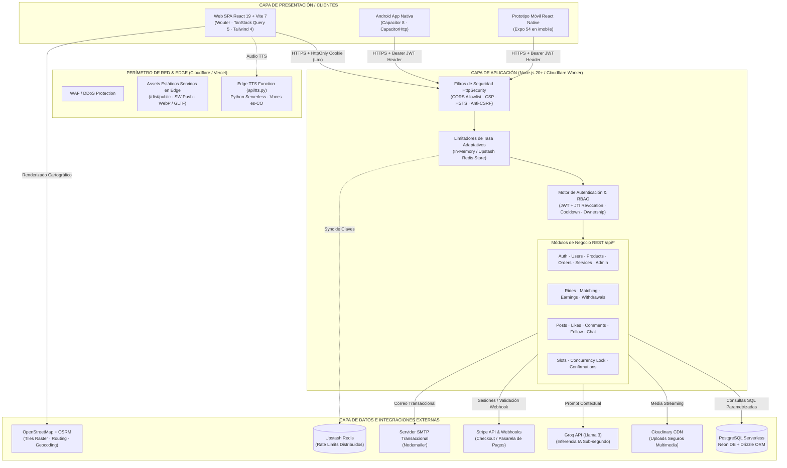
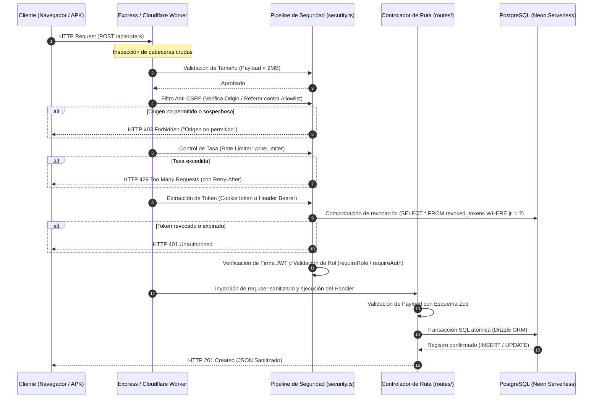
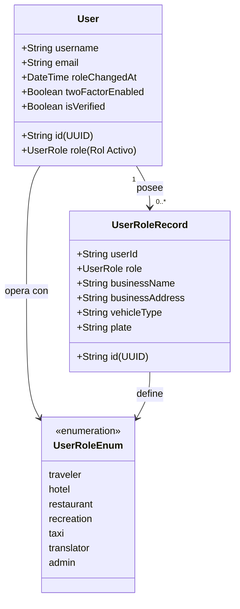
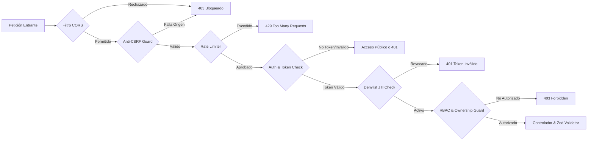
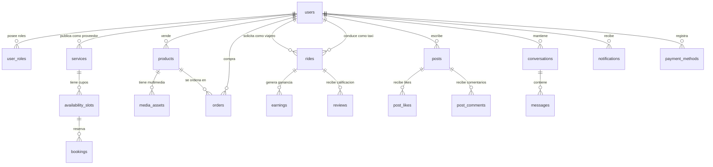

# <div align="center">🇨🇴 ViaNovaIA — Plataforma Integral de Turismo Inteligente, Movilidad y Comercio Local</div>

<div align="center">


<p align="center">
  <b>El ecosistema digital de turismo de Colombia que fusiona Inteligencia Artificial, Marketplace de Alta Transaccionalidad, Red Social Turística (ViaSocial), Despacho de Movilidad/Taxi en Tiempo Real, Visores Inmersivos 3D/360° y Arquitectura de Alta Seguridad.</b>
</p>

</div>

---

## 📑 Tabla de Contenidos

1. [Visión General del Proyecto](#1-visión-general-del-proyecto)
2. [Arquitectura del Sistema y Diagramas de Flujo](#2-arquitectura-del-sistema-y-diagramas-de-flujo)
3. [Stack Tecnológico Integral](#3-stack-tecnológico-integral)
4. [Estructura del Repositorio y Monorepo](#4-estructura-del-repositorio-y-monorepo)
5. [Módulos Funcionales del Negocio](#5-módulos-funcionales-del-negocio)
   - 5.1 [Motor de Descubrimiento Turístico y Mapas Libres](#51-motor-de-descubrimiento-turístico-y-mapas-libres)
   - 5.2 [Asistente IA Contextual y Copiloto de Negocios (Groq)](#52-asistente-ia-contextual-y-copiloto-de-negocios-groq)
   - 5.3 [Marketplace e Inventario Atómico](#53-marketplace-e-inventario-atómico)
   - 5.4 [Módulo de Taxi y Movilidad Urbana](#54-módulo-de-taxi-y-movilidad-urbana)
   - 5.5 [ViaSocial — Red Social y Mensajería Privada](#55-viasocial--red-social-y-mensajería-privada)
   - 5.6 [Motor de Disponibilidad y Bloqueo Temporal de Reservas](#56-motor-de-disponibilidad-y-bloqueo-temporal-de-reservas)
   - 5.7 [Motor de Notificaciones y Push en Tiempo Real](#57-motor-de-notificaciones-y-push-en-tiempo-real)
   - 5.8 [Centro Multimedia Inmersivo (3D, 360°, VR)](#58-centro-multimedia-inmersivo-3d-360-vr)
   - 5.9 [Servicio de Text-to-Speech (Edge TTS Multilingüe)](#59-servicio-de-text-to-speech-edge-tts-multilingüe)
6. [Modelo de Identidad, Multi-Rol y Gobernanza RBAC](#6-modelo-de-identidad-multi-rol-y-gobernanza-rbac)
7. [Arquitectura de Seguridad y Defensa en Profundidad](#7-arquitectura-de-seguridad-y-defensa-en-profundidad)
   - 7.1 [Ciclo de Vida de Sesión y Denylist de Tokens (JTI)](#71-ciclo-de-vida-de-sesión-y-denylist-de-tokens-jti)
   - 7.2 [Protección CSRF y Modelo de Orígenes Permitidos](#72-protección-csrf-y-modelo-de-orígenes-permitidos)
   - 7.3 [CORS y Cabeceras HTTP de Seguridad (CSP, HSTS)](#73-cors-y-cabeceras-http-de-seguridad-csp-hsts)
   - 7.4 [Sistema Multi-Nivel de Rate Limiting (Redis / In-Memory)](#74-sistema-multi-nivel-de-rate-limiting-redis--in-memory)
   - 7.5 [Criptografía y Blindaje de Métodos de Pago (AES-256-GCM)](#75-criptografía-y-blindaje-de-métodos-de-pago-aes-256-gcm)
   - 7.6 [Validación de Uploads por Magic Bytes y Cloudinary](#76-validación-de-uploads-por-magic-bytes-y-cloudinary)
   - 7.7 [Mitigación de SSRF en Resolución de Mapas](#77-mitigación-de-ssrf-en-resolución-de-mapas)
   - 7.8 [Filtro de Profanidad y Sanitización XSS](#78-filtro-de-profanidad-y-sanitización-xss)
8. [Modelo de Datos y Diccionario de Tablas (PostgreSQL / Drizzle)](#8-modelo-de-datos-y-diccionario-de-tablas-postgresql--drizzle)
9. [Catálogo Completo de la API REST](#9-catálogo-completo-de-la-api-rest)
10. [Arquitectura Frontend, Temas e Internacionalización](#10-arquitectura-frontend-temas-e-internacionalización)
11. [Plataformas Móviles (Android Capacitor y Prototipo Expo)](#11-plataformas-móviles-android-capacitor-y-prototipo-expo)
12. [Despliegues Multi-Nube (Cloudflare Workers, Vercel, Node)](#12-despliegues-multi-nube-cloudflare-workers-vercel-node)
13. [Variables de Entorno y Secretos del Sistema](#13-variables-de-entorno-y-secretos-del-sistema)
14. [Guía de Ejecución Local y Comandos del Proyecto](#14-guía-de-ejecución-local-y-comandos-del-proyecto)
15. [Aseguramiento de Calidad (QA), E2E y Auditorías](#15-aseguramiento-de-calidad-qa-e2e-y-auditorías)
16. [Manual de Solución de Problemas (Troubleshooting Runbook)](#16-manual-de-solución-de-problemas-troubleshooting-runbook)
17. [Limitaciones Conocidas y Hoja de Ruta (Roadmap)](#17-limitaciones-conocidas-y-hoja-de-ruta-roadmap)

---

## 1. Visión General del Proyecto

**ViaNovaIA** nace como una solución digital de estándar empresarial orientada a democratizar, conectar y digitalizar el ecosistema de turismo y comercio local en Colombia. La plataforma unifica en una sola experiencia omnicanal a los viajeros nacionales e internacionales con los proveedores locales de servicios (hoteles, restaurantes, operadores recreativos, traductores/guías y taxistas).

A diferencia de las aplicaciones turísticas tradicionales, ViaNovaIA incorpora capacidades de vanguardia:
- **Asistente IA Contextual de Alto Rendimiento:** Emplea LLMs ultrarrápidos (vía Groq) capaces de recordar las preferencias del viajero, acceder al inventario real en base de datos y ofrecer modo copiloto financiero para los comerciantes.
- **Transaccionalidad y Gobernanza Estricta:** Motor de pedidos con reserva atómica de inventario (bloqueo optimista/pesimista para evitar sobreventas), pasarela Stripe y pasarelas locales simuladas (Nequi, Daviplata, Efectivo).
- **Movilidad Urbana Segura (Módulo Taxi):** Modelo de despacho peer-to-peer con cálculo de tarifas dinámicas en pesos colombianos (COP), geolocalización basada en OpenStreetMap (sin costes abusivos de licencias comerciales) y billetera de retiros para conductores.
- **Red Social Inmersiva (ViaSocial):** Interacción en comunidad mediante publicaciones de fotos, videos de alta definición, visores 360° panorámicos y modelos 3D interactivos vía Three.js / WebGL.
- **Seguridad de Nivel Financiero:** Auditada formalmente bajo controles OWASP Top 10 (remediación exhaustiva de vectores P0/P1/P2), tokens JWT revocables mediante denylist `jti`, cifrado AES-256-GCM para métodos de pago y arquitectura de orígenes de confianza (anti-CSRF).

---

## 2. Arquitectura del Sistema y Diagramas de Flujo

El sistema está diseñado bajo el principio de **Monolito Modular Portátil**: la lógica de negocio central (Express 4) puede ejecutarse tanto en un contenedor Node.js tradicional como compilarse para el Edge sobre **Cloudflare Workers** mediante el adaptador `cloudflare:node`, o funcionar como Serverless Functions en **Vercel**.

### 2.1 Diagrama de Arquitectura Global



### 2.2 Ciclo de Vida de una Petición Segura (Request Flow)



---

## 3. Stack Tecnológico Integral

El proyecto fue construido utilizando únicamente dependencias probadas para entornos de alta concurrencia y bajo consumo de memoria:

### Frontend
- **React 19 (`^19.2.0`) & React DOM:** Aprovecha el nuevo compilador y la gestión asíncrona de renderizado de React 19.
- **TypeScript 5.6 (`5.6.3`):** Tipado estático riguroso a nivel de componentes, llamadas de red y esquemas de datos compartidos.
- **Vite 7 (`^7.1.9`):** Servidor de desarrollo ultrarrápido y empaquetador ESM de producción.
- **Wouter (`^3.3.5`):** Enrutador declarativo minimalista (~1.5 KB) optimizado para SPAs ligeras en sustitución de React Router.
- **TanStack Query 5 (`^5.60.5`):** Gestión de caché reactiva, invalidación automática de queries, reintentos exponenciales y mutaciones optimistas.
- **Tailwind CSS 4 (`^4.1.14`) + PostCSS:** Motor de utilidades de diseño con arquitectura CSS-first de nueva generación.
- **Radix UI & Componentes shadcn/ui:** Primitivas de UI accesibles (WAI-ARIA) que incluyen Diálogos, Dropdowns, Tabs, Tooltips, Sliders, Acordeones y Toasts.
- **Framer Motion (`^12.23.24`):** Animaciones fluidas, transiciones de microinteracción y estados cinemáticos.
- **Recharts (`^2.15.4`):** Visualización interactiva de métricas analíticas (gráficos de línea, barras y distribución).
- **MapLibre GL JS (`^6.15.0`) & Leaflet (`^1.9.4`):** Renderizado cartográfico basado en WebGL y mapas interactivos usando OpenStreetMap.
- **Three.js (`^0.182.0`), React Three Fiber (`^9.4.0`) & Google Model Viewer:** Motor 3D/VR para inspección inmersiva de modelos GLTF/GLB y fotografía 360°.
- **next-themes (`^0.4.6`):** Gestor multitema (`light`, `dark`, `sunset`, `ocean`, `forest`) aplicado vía clases de HTML sin parpadeos de carga.
- **i18next (`^26.2.0`) & react-i18next:** Sistema de internacionalización con soporte para 5 idiomas (`es`, `en`, `fr`, `pt`, `zh`).

### Backend
- **Node.js 20+ LTS / Cloudflare Workers:** Runtimes de ejecución compatibles tanto con servidores tradicionales como con aislamiento en el Edge.
- **Express 4 (`^4.22.3`):** Núcleo HTTP de enrutamiento modular y middlewares.
- **Drizzle ORM (`^0.45.2`) & Drizzle Kit:** ORM tipado de cero sobrecarga computacional con soporte para transacciones complejas.
- **@neondatabase/serverless (`^0.10.4`):** Driver PostgreSQL optimizado para conexiones HTTP y WebSockets sobre infraestructuras serverless.
- **Zod (`^3.25.76`) & drizzle-zod:** Validación de contratos, sanitización de entrada y coerción de tipos.
- **jsonwebtoken (`^9.0.3`) & bcryptjs (`^3.0.3`):** Criptografía de sesiones (HS256) y hashing resistente a fuerza bruta (12 rondas con compatibilidad pgcrypto `$2a$`).
- **express-rate-limit (`^8.5.2`) + Adaptador Upstash Redis:** Limitación granular de solicitudes HTTP.
- **Cloudinary SDK (`^2.9.0`) & Multer:** Almacenamiento perimetral de archivos multimedia con validación estricta de cabeceras de bytes.
- **Nodemailer (`^10.2.1`):** Envío de correos transaccionales seguros con plantillas HTML integradas.
- **Stripe Node SDK (`^22.1.1`):** Orquestación de sesiones de pago Checkout y verificación criptográfica de Webhooks.
- **Groq SDK (Llama 3 / Mixtral):** Inferencia ultrarrápida para el Asistente Conversacional.
- **Edge TTS (`edge-tts` en Python):** Síntesis de voz neural con acentos nativos colombianos.

### Infraestructura, Móvil y DevOps
- **Capacitor 8 (`^8.5.3`):** Empaquetado nativo para Android con puente `CapacitorHttp` para omitir bloqueos CORS en apps híbridas.
- **Expo 54 / React Native 0.81:** Subproyecto de laboratorio en `/mobile` para investigación de componentes móviles puros.
- **Cloudflare Wrangler (`^4.44.0`):** CLI de orquestación y despliegue hacia Cloudflare Workers.
- **Vercel CLI:** Soporte Serverless Functions para el backend Express y script de voz Python.

---

## 4. Estructura del Repositorio y Monorepo

```text
ViaNovaIA/
├── android/                         # Proyecto Nativo Android (Gradle + Capacitor 8)
│   ├── app/                         # Código fuente nativo, AndroidManifest.xml y assets
│   └── build.gradle                 # Configuración del compilador Gradle
├── api/                             # Serverless Functions para despliegues en Vercel
│   ├── index.ts                     # Wrapper Serverless Express para Vercel
│   └── tts.py                       # Microservicio Edge TTS en Python para audio multilingüe
├── assets/                          # Logos vectoriales, banners y branding del proyecto
├── attached_assets/                 # Recursos multimedia estáticos precargados
├── client/                          # Frontend SPA en React 19 + TypeScript
│   ├── index.html                   # Entry point HTML con meta-tags optimizados
│   ├── public/                      # Archivos públicos directos
│   │   ├── favicon.png              # Icono de la plataforma
│   │   └── sw.js                    # Service Worker para notificaciones push web
│   └── src/
│       ├── main.tsx                 # Inicialización de la aplicación React
│       ├── App.tsx                  # Matriz de enrutamiento SPA (Wouter) y ThemeProvider
│       ├── components/              # Biblioteca de componentes modulares
│       │   ├── Navbar.tsx           # Barra de navegación inteligente reactiva al rol
│       │   ├── Chatbot.tsx          # Asistente IA flotante con síntesis de voz y memoria
│       │   ├── MapView.tsx          # Componente de mapas MapLibre con tiles OSM
│       │   ├── CardItem.tsx         # Tarjeta unificada de servicios y productos
│       │   ├── TaxiOrderPanel.tsx   # Panel de control de viaje para viajeros
│       │   ├── PaymentMethods.tsx   # Billetera de métodos de pago seguros
│       │   ├── ReviewSystem.tsx     # Calificaciones y reseñas bidireccionales
│       │   ├── ProviderCalendar.tsx # Gestión de disponibilidad y agenda
│       │   ├── VRViewer.tsx         # Visor inmersivo para experiencias de realidad virtual
│       │   ├── ErrorBoundary.tsx    # Capturador de fallos de renderizado
│       │   ├── media/               # Visores especializados (Viewer3D, Viewer360, Gallery)
│       │   ├── taxi/                # Componentes exclusivos del taxista (TaxiMap, StatsBar, ActiveRide)
│       │   └── ui/                  # Componentes base shadcn/ui (Button, Dialog, Input, Toast...)
│       ├── pages/                   # Páginas y vistas principales de la aplicación
│       │   ├── Home.tsx             # Landing turística, buscador y mapa interactivo
│       │   ├── Login.tsx            # Formulario unificado de Login, Registro, 2FA y Reset
│       │   ├── Dashboard.tsx        # Panel de control del viajero / consumidor
│       │   ├── ProviderDashboard.tsx# Panel avanzado para proveedores (Hoteles/Restaurantes)
│       │   ├── AdminDashboard.tsx   # Panel de supervisión, auditoría y métricas globales
│       │   ├── ProductManager.tsx   # Administración de catálogo comercial (/products)
│       │   ├── ProductStore.tsx     # Vitrina pública y marketplace de productos (/explore)
│       │   ├── MyProducts.tsx       # Gestión de servicios turísticos del proveedor (/my-products)
│       │   ├── SocialFeed.tsx       # Muro social interactivo de ViaSocial (/social)
│       │   ├── Messages.tsx         # Mensajería directa encriptada en tránsito (/messages)
│       │   ├── UserProfile.tsx      # Perfil público de usuarios y comerciantes (/u/:username)
│       │   ├── Notifications.tsx    # Bandeja de notificaciones en tiempo real
│       │   ├── AccountSettings.tsx  # Seguridad, 2FA, sesiones y borrado de cuenta
│       │   ├── RoleSelection.tsx    # Activación y alternancia de perfiles de negocio
│       │   ├── RideHistory.tsx      # Historial de viajes realizados
│       │   ├── Privacy.tsx          # Políticas de tratamiento de datos personales
│       │   └── taxi/                # Submódulo del conductor
│       │       ├── TaxiDashboard.tsx# Despacho de viajes en vivo y estado disponible
│       │       ├── RequestRide.tsx  # Solicitud de viaje con geolocalización asistida
│       │       ├── RideDetail.tsx   # Seguimiento del viaje en curso sobre mapa
│       │       └── TaxiEarnings.tsx # Billetera, liquidación de ganancias y retiros
│       ├── lib/                     # Librerías de utilidad de cliente
│       │   ├── auth.ts              # Store Zustand con la sesión y persistencia local
│       │   ├── queryClient.ts       # Configuración global de TanStack Query y apiBase
│       │   ├── map-style.ts         # Estilo de mapa raster OpenStreetMap
│       │   ├── maplibre-worker.ts   # Carga aislada del worker de MapLibre sin bundling roto
│       │   ├── i18n.ts              # Inicialización y catálogos de traducción
│       │   └── geo.ts               # Utilidades de cálculo de distancias y geolocalización
│       └── styles/                  # Hojas de estilo globales y tokens de Tailwind
├── docs/                            # Documentación técnica, manuales y checklists
│   └── CHECKLIST_QA_VIANOVA.md      # Protocolo de pruebas QA, E2E y matriz de verificación
├── mobile/                          # Prototipo independiente en React Native / Expo
│   ├── App.tsx                      # Entry point de la aplicación móvil Expo
│   └── package.json                 # Dependencias aisladas del cliente móvil
├── scripts/                         # Utilidades de mantenimiento, migración y pruebas
│   ├── e2e-ui-full-test.mjs         # Suite E2E completa en Chromium headless
│   ├── prepare-cloudflare-assets.mjs# Limpieza de artefactos pesados para Cloudflare (<25MB)
│   ├── migrate-phase1.mjs           # Migración Drizzle Fase 1 (Usuarios y roles)
│   ├── migrate-phase2.mjs           # Migración Drizzle Fase 2 (Servicios y reseñas)
│   ├── migrate-phase4.mjs           # Migración Drizzle Fase 4 (Red social y mensajería)
│   ├── migrate-phase5.ts            # Migración Drizzle Fase 5 (Billetera y taxi)
│   └── migrate-phase6.mjs           # Migración Drizzle Fase 6 (Índices y blindajes)
├── server/                          # Backend Express 4 y controladores
│   ├── index.ts                     # Punto de entrada para ejecución en Node.js (Puerto 5000)
│   ├── app.ts                       # Fábrica de Express: seguridad, CSRF, JSON y handlers
│   ├── worker.ts                    # Punto de entrada para Cloudflare Workers (cloudflare:node)
│   ├── config.ts                    # Gestión y aserciones de variables de entorno críticas
│   ├── security.ts                  # Núcleo de autenticación, JWT, RBAC, AES-256 y hashing
│   ├── http-security.ts             # Configuración de CORS, CSP estricto y cabeceras HTTP
│   ├── rate-limits.ts               # Definición de limitadores de tasa por criticidad
│   ├── rate-limit-store.ts          # Almacén de rate limits en memoria y soporte Redis
│   ├── storage.ts                   # Capa de abstracción de datos Drizzle ORM
│   ├── taxi.storage.ts              # Capa de datos especializada para el módulo de movilidad
│   ├── analytics.ts                 # Métricas de negocio y auto-creación del esquema extendido
│   ├── mailer.ts                    # Servicio transaccional de correo (Nodemailer)
│   ├── google-auth.ts               # Validación de tokens OAuth y Google Mobile ID Tokens
│   ├── observability.ts             # Registro estructurado de eventos de seguridad y errores
│   ├── upload-validation.ts         # Inspección de magic bytes y validación MIME de uploads
│   ├── static.ts                    # Servidor de archivos estáticos en producción
│   ├── vite.ts                      # Middleware de integración Vite HMR en desarrollo
│   └── routes/                      # Enrutadores divididos por dominio
│       ├── index.ts                 # Rutas de autenticación, catálogo, marketplace, pagos
│       ├── taxi.routes.ts           # Rutas del servicio de taxi, viajes y finanzas
│       ├── bookings.routes.ts       # Rutas del motor de reservas y disponibilidad
│       └── social.routes.ts         # Rutas de ViaSocial, feed, interacciones y chats
├── shared/                          # Código universal compartido entre Frontend y Backend
│   ├── schema.ts                    # Esquemas de tablas principales en Drizzle ORM y tipos Zod
│   └── taxi.schema.ts               # Esquemas específicos de carreras, tarifas y retiros
├── capacitor.config.ts              # Configuración del empaquetado nativo Android
├── cloudflare-node.d.ts             # Tipados para la API de Cloudflare Workers
├── drizzle.config.ts                # Configuración de Drizzle Kit para migraciones
├── package.json                     # Manifiesto de dependencias y scripts NPM
├── tsconfig.json                    # Configuración del compilador TypeScript
├── vercel.json                      # Reglas de ruteo y serverless functions en Vercel
├── vite.config.ts                   # Configuración del empaquetador Vite 7
└── wrangler.jsonc                   # Manifiesto de despliegue para Cloudflare Workers
```

---

## 5. Módulos Funcionales del Negocio

### 5.1 Motor de Descubrimiento Turístico y Mapas Libres
Permite a los usuarios explorar la riqueza turística de Colombia mediante una experiencia visual ágil:
- **Catálogo por Categorías:** Hoteles, Restaurantes, Actividades Recreativas, Transporte y Traductores.
- **Cartografía OpenStreetMap (MapLibre GL JS & Leaflet):** Renderizado de alta resolución sin dependencia de APIs comerciales ni costos por consumo. Usa la capa pública de tiles raster `https://tile.openstreetmap.org/{z}/{x}/{y}.png`.
- **Modo Oscuro Inteligente en Mapas:** Invierte dinámicamente mediante CSS únicamente el `<canvas>` cartográfico, preservando los colores naturales de los marcadores, fotos y controles.
- **Filtros Avanzados y Reseñas:** Búsqueda en tiempo real con puntuaciones por estrellas, comentarios verificados y cálculo de distancias relativas.

### 5.2 Asistente IA Contextual y Copiloto de Negocios (Groq)
El asistente (`Chatbot.tsx`) no es un simple bot conversacional; actúa como un agente inteligente de viaje y un asesor financiero para los comercios:
- **Modo Viajero:** Asiste en el itinerario recomendando destinos colombianos reales, consultando precios y disponibilidad en la base de datos de ViaNovaIA.
- **Modo Copiloto de Negocio:** Cuando el usuario autenticado tiene un rol comercial (hotel, restaurante, etc.), el asistente inyecta en el prompt métricas reales de los últimos 30 días calculadas en `server/analytics.ts`:
  - Ingresos netos, costos directos (COGS) y comisiones de plataforma.
  - Órdenes pagadas vs. pendientes y ticket promedio.
  - Estado del inventario: unidades totales, productos bajo stock y artículos agotados.
  - Alertas prioritarias de reabastecimiento y sugerencias de margen comercial.
- **Modo Resiliente / Offline Fallback:** Si la API de Groq no se encuentra accesible o agota su cuota, el backend intercepta el fallo y genera un resumen analítico heurístico directamente con los datos de PostgreSQL sin romper la experiencia del usuario.

### 5.3 Marketplace e Inventario Atómico
Infraestructura completa para el comercio electrónico de productos y artesanías locales:
- **Control Estricto de Stock:** Al registrar una orden (`POST /api/orders`), se verifica y descuenta el inventario de manera transaccional. Si el producto se cancela o expira, el stock se repone automáticamente.
- **Soporte de Idempotencia:** Evita el doble cobro mediante la cabecera `Idempotency-Key` en operaciones críticas de compra.
- **Integración Stripe Checkout:** Generación de sesiones alojadas seguras (`POST /api/stripe/create-checkout-session`). La confirmación de la orden depende exclusivamente del evento validado criptográficamente recibido en `POST /api/stripe/webhook`.
- **Galería de Medios de Producto:** Cada producto admite múltiples recursos asociados (`media_assets`): imágenes de alta definición, videos promocionales, modelos 3D interactivos y recorridos virtuales 360°.

### 5.4 Módulo de Taxi y Movilidad Urbana
Sistema integral de transporte local diseñado para conectar pasajeros con taxistas autorizados:
- **Estimación Automatizada de Tarifas:** Calcula la distancia euclidiana/vial en kilómetros y aplica un algoritmo tarifario transparente en pesos colombianos (COP):
  $$\text{Tarifa} = \max(\text{Tarifa Base} + (\text{Distancia Km} \times \text{Precio por Km}), \text{Tarifa Mínima})$$
- **Máquina de Estados de la Carrera:**
  $$\text{pending} \xrightarrow{\text{Conductor acepta}} \text{accepted} \xrightarrow{\text{Inicio de viaje}} \text{in\_progress} \xrightarrow{\text{Destino alcanzado}} \text{completed}$$
  En cualquier etapa previa a la finalización, la carrera puede transicionar a `cancelled`.
- **Billetera del Taxista y Retiros:** Cada viaje completado genera un registro inmutable en la tabla `earnings`. El conductor puede monitorear su saldo acumulado y solicitar liquidaciones a través de `POST /api/taxi/withdraw` con validación previa de fondos disponibles.
- **Protección de Privacidad (Anti-Doxxing):** En las consultas públicas de taxistas cercanos (`GET /api/taxi/nearby`), el sistema enmascara la placa y el número telefónico del conductor hasta que una carrera es formalmente pactada entre ambas partes.

### 5.5 ViaSocial — Red Social y Mensajería Privada
Plataforma comunitaria integrada para incentivar el turismo experiencial:
- **Publicaciones Multimedia:** Soporte para texto enriquecido, imágenes optimizadas, videos y enlaces directos a servicios o ubicaciones turísticas registradas.
- **Mecanismos de Interacción:** Sistema de "Me gusta" (`post_likes`), hilos de comentarios sanitizados (`post_comments`) y seguimiento de perfiles (`social_follow`).
- **Seguridad y Moderación Ciudadana:** Bloqueo de usuarios maliciosos (`social_blocks`) que filtra automáticamente sus publicaciones en el feed, y formulario de denuncias (`social_reports`) para revisión administrativa.
- **Mensajería Instantánea:** Conversaciones privadas uno a uno (`social_messages`) con conteo de mensajes no leídos y marcas de lectura.

### 5.6 Motor de Disponibilidad y Bloqueo Temporal de Reservas
Diseñado para hoteles y restaurantes que requieren gestionar cupos (mesas, habitaciones o cupos horarios):
- **Slots de Disponibilidad:** Configuración granular de fechas de inicio, finalización y capacidad máxima (`availability_slots`).
- **Bloqueo Optimista de Concurrencia:** Durante el proceso de pago o confirmación, el sistema aplica un bloqueo temporal atómico (`lockedUntil` fijado a 5 minutos). Si la reserva no se confirma en dicho intervalo, el slot se libera automáticamente para otros usuarios sin intervención humana.

### 5.7 Motor de Notificaciones y Push en Tiempo Real
- **Notificaciones del Sistema:** Registro automático de alertas para proveedores y viajeros ante nuevos pedidos, cambios de estado de viajes y solicitudes de reserva.
- **Service Worker Web:** Archivo `client/public/sw.js` preconfigurado para gestionar notificaciones push en el navegador.
- **Derivación Segura de Propiedad:** Las notificaciones se obtienen y actualizan (`GET /api/notifications` y `PATCH /api/notifications/:id/read`) ligando la consulta al username autenticado extraído del token JWT, imposibilitando la lectura de notificaciones de terceros.

### 5.8 Centro Multimedia Inmersivo (3D, 360°, VR)
- **Visor 3D (`Viewer3D.tsx`):** Utiliza `<model-viewer>` y Three.js para renderizar piezas arqueológicas, artesanías o modelos a escala con iluminación dinámica y soporte para Realidad Aumentada (AR) en dispositivos compatibles.
- **Visor 360° (`Viewer360.tsx`):** Renderiza texturas esféricas interactivas permitiendo a los turistas "caminar" virtualmente por habitaciones de hotel o senderos ecológicos.

### 5.9 Servicio de Text-to-Speech (Edge TTS Multilingüe)
- Microservicio implementado en `api/tts.py` para sintetizar texto a voz con entonación natural colombiana:
  - `es-CO-GonzaloNeural` (Voz masculina colombiana).
  - `es-CO-SalomeNeural` (Voz femenina colombiana).
  - Voces complementarias para inglés (`en-US`), francés (`fr-FR`), portugués (`pt-BR`) y chino (`zh-CN`).
- Protegido por autenticación obligatoria (JWT Bearer) y limitador de tasa independiente para evitar abusos de consumo.

---

## 6. Modelo de Identidad, Multi-Rol y Gobernanza RBAC

ViaNovaIA implementa un modelo de control de acceso basado en roles (**RBAC**) híbrido y flexible:



### Reglas Cardinales de los Roles:
1. **Registro Público Restringido:** Todo nuevo usuario registrado a través de la interfaz pública adquiere inequívocamente el rol base `traveler`. El rol `admin` **jamás puede ser autoasignado**.
2. **Arquitectura Multi-Rol:** Un usuario puede ser simultáneamente un viajero y poseer uno o varios roles comerciales (ej: tener un restaurante y conducir un taxi). Cada rol comercial se almacena en la tabla `user_roles`.
3. **Rol Activo (`users.role`):** Representa el contexto bajo el cual el usuario está navegando en la aplicación en un momento determinado. Se conmuta mediante `PATCH /api/users/active-role`, validando que el usuario efectivamente posea dicho rol en `user_roles`.
4. **Política de Cooldown en Cambio de Rol Principal:** Al modificar el rol principal mediante `PATCH /api/users/role`, el sistema aplica una restricción obligatoria de **15 días de espera** (`role_changed_at`) para prevenir fraudes comerciales o evasión de calificaciones, a menos que la operación sea ejecutada por un Administrador.
5. **Principio de Mínimo Privilegio y Ownership:** Poseer el rol requerido no basta. El backend valida siempre la propiedad del recurso mediante la función `isOwnerOrAdmin()`: un hotelero solo puede editar sus propios servicios y productos.

---

## 7. Arquitectura de Seguridad y Defensa en Profundidad

Tras la exhaustiva auditoría técnica consolidada en `INFORME_QA_SEGURIDAD_VIANOVA.md`, el sistema fue sometido a una remediación integral de grado militar que garantiza el cumplimiento estricto de las directrices OWASP:



### 7.1 Ciclo de Vida de Sesión y Denylist de Tokens (JTI)
- **Emisión Segura de Tokens:** El token JWT se firma exclusivamente con un secreto criptográfico de alta entropía (`JWT_SECRET` $\ge$ 32 caracteres) con vigencia de 120 minutos.
- **Cookies HttpOnly:** En entornos web de producción, la cookie `token` se emite con las directivas `HttpOnly`, `SameSite=Lax` y `Secure`. El token no se expone a scripts de JavaScript en el navegador.
- **Compatibilidad con Clientes Nativos:** Clientes móviles nativos (Capacitor y Expo) pueden autenticar transmitiendo el encabezado estándar `Authorization: Bearer <token>`.
- **Revocación Instantánea (Logout Real):** Cada token generado incluye un identificador único criptográfico `jti` (UUIDv4). Al cerrar sesión (`POST /api/auth/logout`), el `jti` se persiste en la tabla `revoked_tokens` hasta su fecha natural de expiración. Cada petición entrante comprueba que el `jti` no figure en esta lista negra.

### 7.2 Protección CSRF y Modelo de Orígenes Permitidos
- El middleware `csrfProtection` en `server/security.ts` intercepta todas las peticiones mutantes (`POST`, `PUT`, `PATCH`, `DELETE`).
- Se verifica estrictamente que los encabezados `Origin` o `Referer` coincidan con la lista blanca oficial (`CLIENT_URL`, `APP_URL`, `PUBLIC_URL`, `CORS_ALLOWED_ORIGINS`).
- Si una petición arriba con una cookie de sesión pero carece de un origen confiable, el servidor aborta la operación inmediatamente respondiendo **HTTP 403**.

### 7.3 CORS y Cabeceras HTTP de Seguridad (CSP, HSTS)
- **Content Security Policy (CSP) Estricto:** Previene ataques de inyección de código (XSS), autorizando únicamente fuentes explícitas para scripts, fuentes tipográficas (`fonts.googleapis.com`), modelos y tiles cartográficos.
- **Cabeceras Defensivas:**
  - `X-Frame-Options: DENY` (Mitigación total de Clickjacking).
  - `X-Content-Type-Options: nosniff` (Inhabilita el MIME-type sniffing).
  - `Referrer-Policy: strict-origin-when-cross-origin`.
  - `Permissions-Policy: geolocation=(self), microphone=(self), camera=(self), payment=(), usb=()`.
  - `Strict-Transport-Security (HSTS): max-age=31536000; includeSubDomains` (Forzado HTTPS en producción).

### 7.4 Sistema Multi-Nivel de Rate Limiting (Redis / In-Memory)
Para neutralizar ataques de denegación de servicio (DoS) y fuerza bruta, el backend aplica 12 limitadores independientes definidos en `server/rate-limits.ts`:

| Limitador | Ventana | Límite Máx. | Propósito y Rutas Protegidas |
|---|---:|---:|---|
| `authLimiter` | 15 min | 10 req | `/api/auth/login`, `/api/auth/google` |
| `registerLimiter` | 60 min | 5 req | `/api/auth/register` (Control por IP) |
| `twoFactorLimiter` | 15 min | 5 req | `/api/auth/verify-2fa` (Anti-fuerza bruta de OTP) |
| `verifyEmailLimiter` | 15 min | 10 req | `/api/auth/verify-email` |
| `forgotPasswordLimiter` | 60 min | 5 req | `/api/auth/forgot-password` (Anti-spam de correos) |
| `resetTokenLimiter` | 15 min | 10 req | `/api/auth/verify-reset-token`, `/reset-password` |
| `uploadLimiter` | 60 min | 20 req | `/api/upload`, `/api/products/:id/media` |
| `chatLimiter` | 1 min | 20 req | `/api/chat` (Control de consumo en Groq) |
| `writeLimiter` | 15 min | 60 req | Operaciones mutantes generales de catálogo |
| `bookingRequestLimiter`| 60 min | 10 req | `/api/bookings/request` |
| `mapsLimiter` | 15 min | 30 req | `/api/maps/resolve` (Anti-scraping y control SSRF) |
| `publicReadLimiter` | 15 min | 300 req | Endpoints de consulta pública y notificaciones |

### 7.5 Criptografía y Blindaje de Métodos de Pago (AES-256-GCM)
- Los datos confidenciales de cuentas financieras y billeteras digitales (Nequi, Daviplata, cuentas bancarias) se cifran en reposo utilizando el algoritmo de grado militar **AES-256-GCM** con vector de inicialización (IV) único y etiqueta de autenticación (Auth Tag).
- En ninguna circunstancia la API retorna la información confidencial en plano; el sistema aplica enmascaramiento estricto (`****1234`) antes de responder al cliente.

### 7.6 Validación de Uploads por Magic Bytes y Cloudinary
- La seguridad en la subida de archivos no depende de la extensión declarada por el usuario. La librería `server/upload-validation.ts` examina la secuencia inicial de bytes en el búfer (**Magic Numbers**) para confirmar la naturaleza genuina del archivo (JPEG: `FF D8 FF`, PNG: `89 50 4E 47`, WebP: `52 49 46 46`, MP4: `66 74 79 70`, GLTF: `67 6C 54 46`).
- Archivos que no coincidan con su tipo MIME real son rechazados inmediatamente con **HTTP 415 (Unsupported Media Type)**.
- El destino en Cloudinary se deriva inequívocamente del ID de usuario autenticado en la sesión, impidiendo la sobrescritura de recursos ajenos.

### 7.7 Mitigación de SSRF en Resolución de Mapas
El endpoint `GET /api/maps/resolve` valida enlaces compartidos de Google Maps:
- Permite exclusivamente los dominios canónicos de Google (`maps.google.com`, `goo.gl`, `maps.app.goo.gl`).
- Bloquea activamente la resolución hacia direcciones IP de loopback (`127.0.0.1`, `localhost`), rangos privados (RFC 1918) y servicios de metadatos de proveedores cloud (`169.254.169.254`).

### 7.8 Filtro de Profanidad y Sanitización XSS
- Implementación de un filtro especializado de palabras soeces adaptado al vocabulario coloquial colombiano para garantizar un entorno familiar en comentarios, publicaciones y chats con el asistente IA.
- Sanitización de cadenas de entrada mediante escape HTML y normalización de textos.

---

## 8. Modelo de Datos y Diccionario de Tablas (PostgreSQL / Drizzle)

La persistencia de datos está orquestada sobre PostgreSQL a través de esquemas declarativos en **Drizzle ORM** (`shared/schema.ts`, `shared/taxi.schema.ts` y extensiones analíticas en `server/analytics.ts`):



### Diccionario de Tablas Principales:

1. **`users`**: Entidad central de cuentas de usuario.
   - `id` (VARCHAR PK UUID), `username` (TEXT UNIQUE), `password` (TEXT Hash bcrypt), `email` (TEXT), `name` (TEXT), `role` (ENUM user_role), `role_changed_at` (TIMESTAMP), `avatar_url` (TEXT), `is_verified` (TEXT), `verification_token` (TEXT), `failed_login_attempts` (INT), `lock_until` (TIMESTAMP), `preferences` (JSONB con memoria del asistente IA), `two_factor_enabled` (TEXT), `two_factor_attempts` (INT), `auth_provider` (TEXT), `terms_accepted_at` (TIMESTAMP), `deleted_at` (TIMESTAMP).
2. **`user_roles`**: Registro de múltiples roles de negocio por usuario.
   - `id` (VARCHAR PK), `user_id` (FK users.id), `role` (ENUM), `business_name` (TEXT), `business_address` (TEXT), `business_phone` (TEXT), `vehicle_type` (TEXT), `plate` (TEXT), `phone` (TEXT).
3. **`services`**: Catálogo de experiencias, hospedajes y restaurantes.
   - `id` (VARCHAR PK), `provider_username` (TEXT), `category` (ENUM), `name` (TEXT), `description` (TEXT), `image_url` (TEXT), `price` (INT), `currency` (TEXT), `location_lat` / `location_lng` (TEXT), `schedule` (TEXT), `included` (JSONB).
4. **`products`**: Artículos del marketplace gestionados por proveedores.
   - `id` (VARCHAR PK), `provider_id` (FK users.id), `provider_username` (TEXT), `role_category` (TEXT), `name` (TEXT), `description` (TEXT), `price` (NUMERIC), `cost` (NUMERIC), `currency` (TEXT), `stock` (INT, `-1` para ilimitado), `is_active` (BOOL), `cover_image` (TEXT).
5. **`orders`**: Órdenes de compra del marketplace.
   - `id` (VARCHAR PK), `buyer_id` (FK users.id), `product_id` (FK products.id), `quantity` (INT), `unit_price` (NUMERIC), `total` (NUMERIC), `status` (TEXT: `pending`, `paid`, `cancelled`), `payment_intent` (TEXT).
6. **`rides`**: Carreras y solicitudes de taxi.
   - `id` (VARCHAR PK), `traveler_username` (TEXT), `taxi_username` (TEXT NULL hasta ser aceptada), `origin_lat`/`origin_lng` (TEXT), `origin_address` (TEXT), `destination_lat`/`destination_lng` (TEXT), `destination_address` (TEXT), `fare` (REAL en COP), `distance_km` (REAL), `status` (ENUM: `pending`, `accepted`, `in_progress`, `completed`, `cancelled`), `started_at` / `completed_at` (TIMESTAMP).
7. **`earnings`**: Libro contable de ganancias por carrera para conductores.
   - `id` (VARCHAR PK), `taxi_username` (TEXT), `ride_id` (FK rides.id), `amount` (REAL en COP).
8. **`withdrawals`**: Solicitudes de retiro de ganancias de taxistas.
   - `id` (VARCHAR PK), `taxi_username` (TEXT), `amount` (REAL), `status` (ENUM: `pending`, `completed`, `rejected`), `bank_account` (TEXT), `idempotency_key` (TEXT).
9. **`availability_slots`** & **`bookings`**: Motor de reservas con control de concurrencia y bloqueo temporal (`locked_until`).
10. **`posts`**, **`post_likes`**, **`post_comments`**, **`social_messages`**, **`social_blocks`**, **`social_reports`**: Ecosistema social y moderación.
11. **`revoked_tokens`**: Denylist de tokens revocados (`jti` PK, `expires_at`).
12. **`payment_methods`**: Billetera de métodos de pago (`details` cifrado con AES-256-GCM).
13. **`notifications`**: Alertas en tiempo real por usuario.
14. **`media_assets`**: Catálogo multimedia multiformato (imágenes, videos, 360, 3D).

---

## 9. Catálogo Completo de la API REST

Base del servicio: `/api`. Todas las respuestas son en formato `application/json` (salvo descargas multimedia directas y el webhook de Stripe).

### 9.1 Autenticación y Cuentas de Usuario

| Verbo | Ruta | Acceso Requerido | Rate Limit | Descripción y Parámetros Clave |
|---|---|---|---|---|
| `POST` | `/auth/register` | Público | `registerLimiter` | Crea usuario viajero. Body: `username`, `password`, `email`, `name`, `termsAccepted`. |
| `POST` | `/auth/login` | Público | `authLimiter` | Login tradicional. Si 2FA está activo, responde `requires2FA: true`. |
| `POST` | `/auth/verify-2fa` | Público | `twoFactorLimiter` | Valida código de 6 dígitos. Emite JWT en cookie / body nativo. |
| `POST` | `/auth/logout` | Público | Ninguno | Revoca el token en `revoked_tokens` y elimina la cookie `token`. |
| `GET` | `/auth/me` | Opcional | Ninguno | Retorna el usuario autenticado sanitizado o `{ user: null }` (sin error 401). |
| `GET` | `/auth/2fa` | Autenticado | Ninguno | Consulta si el usuario tiene el doble factor activado. |
| `PATCH` | `/auth/2fa` | Autenticado | `writeLimiter` | Habilita o deshabilita 2FA (exige ingresar contraseña actual). |
| `POST` | `/auth/verify-email` | Público | `verifyEmailLimiter`| Verifica el correo mediante token recibido por email. |
| `POST` | `/auth/forgot-password`| Público | `forgotPasswordLimiter`| Envía enlace de recuperación (respuesta temporal uniforme anti-enumeración). |
| `POST` | `/auth/verify-reset-token`| Público| `resetTokenLimiter` | Comprueba validez de un token de recuperación. |
| `POST` | `/auth/reset-password` | Público | `resetTokenLimiter` | Asigna nueva contraseña invalidando sesiones previas. |
| `POST` | `/auth/google/mobile` | Público | `authLimiter` | Autenticación con Google ID Token para apps Capacitor / Android. |
| `GET` | `/auth/google` | Público | `authLimiter` | Inicio de flujo OAuth2 web con Google. |
| `PATCH` | `/user/profile` | Autenticado | `writeLimiter` | Actualiza nombre, bio y URL de avatar. |
| `DELETE`| `/user/account` | Autenticado | `writeLimiter` | Eliminación definitiva (derecho al olvido) con purga de datos. |

### 9.2 Gestión de Roles y Gobernanza de Negocios

| Verbo | Ruta | Acceso Requerido | Rate Limit | Descripción |
|---|---|---|---|---|
| `GET` | `/users/:username/roles` | Opcional | `publicReadLimiter` | Lista los roles registrados del usuario. |
| `POST` | `/users/:username/roles` | Propio / Admin | `writeLimiter` | Registra un nuevo rol de negocio (hotel, taxi, etc.) con datos fiscales. |
| `DELETE`| `/users/:username/roles/:role` | Propio / Admin | `writeLimiter` | Elimina un rol comercial (impide quedarse sin roles). |
| `PATCH` | `/users/active-role` | Autenticado | `writeLimiter` | Alterna el rol activo de trabajo entre los roles poseídos. |
| `PATCH` | `/users/role` | Propio / Admin | `writeLimiter` | Cambia rol principal aplicando cooldown de 15 días. |
| `PATCH` | `/taxi/vehicle` | Taxi / Admin | `writeLimiter` | Actualiza datos del vehículo (tipo, placa y teléfono de contacto). |
| `GET` | `/users/:username/profile`| Público | `publicReadLimiter` | Obtiene el perfil público optimizado para visualización. |
| `GET` | `/admin/stats` | Admin | Ninguno | Panel global: conteo de usuarios, anomalías de seguridad y bloqueos. |
| `GET` | `/analytics/dashboard` | Autenticado | Ninguno | Retorna métricas analíticas (ingresos, stock, órdenes) según el rol. |

### 9.3 Catálogo de Servicios Turísticos

| Verbo | Ruta | Acceso Requerido | Rate Limit | Descripción |
|---|---|---|---|---|
| `GET` | `/services` | Público | `publicReadLimiter` | Servicios por categoría obligatoria (`hotel`, `restaurant`, etc.). |
| `GET` | `/services/provider/:username` | Público | `publicReadLimiter` | Servicios ofertados por un proveedor específico. |
| `POST` | `/services` | Proveedor / Admin | `writeLimiter` | Publica un nuevo servicio turístico (valida propiedad). |
| `PATCH` | `/services/:id` | Dueño / Admin | `writeLimiter` | Modifica precios, descripción, horarios o capacidad del servicio. |
| `DELETE`| `/services/:id` | Dueño / Admin | `writeLimiter` | Elimina lógicamente un servicio del catálogo. |

### 9.4 Marketplace de Productos y Órdenes de Compra

| Verbo | Ruta | Acceso Requerido | Rate Limit | Descripción |
|---|---|---|---|---|
| `GET` | `/products` | Público | `publicReadLimiter` | Catálogo de productos paginado con filtro por categoría. |
| `GET` | `/products/provider/:username` | Público | `publicReadLimiter` | Productos publicados por un comercio (filtra inactivos para terceros). |
| `POST` | `/products` | Proveedor | `uploadLimiter` | Crea producto con imagen de portada (soporta multipart/form-data). |
| `PATCH` | `/products/:id` | Dueño / Admin | `writeLimiter` | Actualiza stock, precios o estado activo del producto. |
| `DELETE`| `/products/:id` | Dueño / Admin | `writeLimiter` | Elimina producto y limpia sus referencias multimedia. |
| `POST` | `/products/:id/media` | Dueño / Admin | `uploadLimiter` | Adjunta archivo multimedia (video, 360, modelo 3D GLTF). |
| `DELETE`| `/products/:id/media/:assetId` | Dueño / Admin | `writeLimiter` | Elimina un activo multimedia vinculado al producto. |
| `POST` | `/orders` | Autenticado | `writeLimiter` | Genera orden de compra descontando stock atómicamente. |
| `GET` | `/orders/buyer/:username` | Propio / Admin | `publicReadLimiter` | Consulta las compras realizadas por el viajero. |
| `GET` | `/orders/provider/:username` | Propio / Admin | `publicReadLimiter` | Consulta las ventas recibidas por el comerciante. |
| `PATCH` | `/orders/:id/status` | Participante / Admin | `writeLimiter` | Transición de estado (`paid`, `cancelled`); repone stock si cancela. |
| `POST` | `/stripe/create-checkout-session` | Autenticado | `writeLimiter` | Inicia sesión de pago en Stripe con redirección a URL de éxito. |
| `POST` | `/stripe/webhook` | Stripe (Firma obligatoria) | Exento | Webhook de Stripe para conciliar órdenes pagadas. |

### 9.5 Módulo de Movilidad y Taxi

| Verbo | Ruta | Acceso Requerido | Rate Limit | Descripción |
|---|---|---|---|---|
| `POST` | `/rides` | Autenticado | `writeLimiter` | Solicita una carrera calculando tarifa en base a coordenadas. |
| `GET` | `/rides/nearby` | Taxi / Admin | `publicReadLimiter` | Lista solicitudes en estado `pending` para conductores. |
| `GET` | `/rides/:id` | Participante / Admin | `publicReadLimiter` | Detalle en tiempo real de una carrera específica. |
| `PATCH` | `/rides/:id` | Participante / Admin | `writeLimiter` | Actualiza el estado (`accepted`, `in_progress`, `completed`, `cancelled`). |
| `GET` | `/rides/taxi/:username` | Propio / Admin | `publicReadLimiter` | Historial de carreras atendidas por el conductor. |
| `GET` | `/rides/traveler/:username` | Propio / Admin | `publicReadLimiter` | Historial de viajes realizados por el pasajero. |
| `PATCH` | `/taxi/status` | Taxi / Admin | `writeLimiter` | Modifica estado de disponibilidad (`isAvailable`) y ubicación GPS. |
| `GET` | `/taxi/nearby` | Autenticado | `publicReadLimiter` | Lista taxistas disponibles cercanos (con datos sensibles enmascarados). |
| `GET` | `/taxi/profile/:username` | Autenticado | `publicReadLimiter` | Perfil del taxista (privado muestra placas; público las oculta). |
| `GET` | `/taxi/earnings/:username` | Propio / Admin | `publicReadLimiter` | Consulta saldo acumulado, carreras liquidadas y retiros. |
| `POST` | `/taxi/withdraw` | Taxi / Admin | `writeLimiter` | Solicita retiro de dinero con validación estricta de saldo disponible. |

### 9.6 Red Social ViaSocial y Mensajería

| Verbo | Ruta | Acceso Requerido | Rate Limit | Descripción |
|---|---|---|---|---|
| `GET` | `/social/posts` | Público | `publicReadLimiter` | Feed social paginado filtrando automáticamente usuarios bloqueados. |
| `POST` | `/social/posts` | Autenticado | `writeLimiter` | Crea una publicación con texto y adjunto multimedia. |
| `DELETE`| `/social/posts/:postId` | Autor / Admin | `writeLimiter` | Elimina una publicación propia. |
| `POST` | `/social/posts/:postId/like` | Autenticado | `writeLimiter` | Agrega un "Me gusta" a la publicación. |
| `DELETE`| `/social/posts/:postId/like` | Autenticado | `writeLimiter` | Retira el "Me gusta". |
| `GET` | `/social/posts/:postId/comments` | Público | `publicReadLimiter` | Lista comentarios asociados a la publicación. |
| `POST` | `/social/posts/:postId/comments` | Autenticado | `writeLimiter` | Comenta una publicación (aplica filtro de groserías). |
| `POST` | `/social/follow` | Autenticado | `writeLimiter` | Sigue a otro usuario de la comunidad. |
| `DELETE`| `/social/follow` | Autenticado | `writeLimiter` | Deja de seguir a un usuario. |
| `POST` | `/social/block` | Autenticado | `writeLimiter` | Bloquea a un usuario para no ver su contenido ni recibir mensajes. |
| `POST` | `/social/report` | Autenticado | `writeLimiter` | Denuncia una cuenta o publicación ante el equipo de moderación. |
| `GET` | `/social/messages/conversations` | Autenticado | `publicReadLimiter` | Lista conversaciones abiertas con otros usuarios. |
| `GET` | `/social/messages/unread/count` | Autenticado | `publicReadLimiter` | Conteo numérico de mensajes privados sin leer. |
| `GET` | `/social/messages/:otherUsername` | Autenticado | `publicReadLimiter` | Historial de mensajes entre dos usuarios. |
| `POST` | `/social/messages` | Autenticado | `writeLimiter` | Envía mensaje directo privado (valida bloqueos cruzados). |

### 9.7 Reservas, Pagos, Notificaciones y Asistente IA

| Verbo | Ruta | Acceso Requerido | Rate Limit | Descripción |
|---|---|---|---|---|
| `POST` | `/bookings/slots` | Proveedor / Admin | `writeLimiter` | Define slots de disponibilidad horaria o de capacidad. |
| `GET` | `/bookings/slots/:serviceId`| Público | `publicReadLimiter` | Consulta cupos disponibles para un servicio específico. |
| `POST` | `/bookings/lock` | Autenticado | `writeLimiter` | Bloqueo temporal atómico por 5 minutos previo al pago. |
| `POST` | `/bookings/confirm` | Dueño / Admin | `writeLimiter` | Confirma definitivamente la reserva liberando o consolidando cupos. |
| `GET` | `/payment-methods/:username` | Propio / Admin | `publicReadLimiter` | Retorna métodos de pago sanitizados (datos confidenciales cifrados). |
| `POST` | `/payment-methods` | Autenticado | `writeLimiter` | Agrega un nuevo método de pago (cifrado con AES-256-GCM). |
| `DELETE`| `/payment-methods/:id` | Dueño | `writeLimiter` | Elimina un método de pago registrado. |
| `PATCH` | `/payment-methods/:id/default`| Dueño | `writeLimiter` | Establece el método como predeterminado para transacciones. |
| `GET` | `/notifications` | Autenticado | `publicReadLimiter` | Obtiene alertas y notificaciones asociadas al usuario autenticado. |
| `PATCH` | `/notifications/:id/read` | Autenticado | `writeLimiter` | Marca notificación propia como leída. |
| `POST` | `/chat` | Autenticado | `chatLimiter` | Envía mensaje al asistente IA contextual (Groq Llama 3). |
| `GET` | `/chat/history` | Autenticado | `publicReadLimiter` | Recupera el historial de conversación del asistente. |
| `POST` | `/upload` | Autenticado | `uploadLimiter` | Carga segura de archivos hacia Cloudinary con verificación de bytes. |
| `GET` | `/maps/resolve` | Autenticado | `mapsLimiter` | Resuelve y valida enlaces de Google Maps con prevención de SSRF. |
| `GET` | `/health` | Público | Ninguno | Healthcheck para monitores de infraestructura (`{"ok": true}`). |

---

## 10. Arquitectura Frontend, Temas e Internacionalización

El cliente web es una Single Page Application (SPA) construida con altos estándares visuales y de rendimiento:
- **Gestor de Estado y Caché Remota:** Se apoya en `@tanstack/react-query` configurado en `client/src/lib/queryClient.ts` con una política de stale-time controlada y sin recargas innecesarias. El estado de autenticación reside en un store ligero **Zustand** (`client/src/lib/auth.ts`) que sincroniza automáticamente la sesión con la cookie HttpOnly y almacena el objeto de usuario en `localStorage`.
- **Diseño Visual con Tailwind CSS 4 y shadcn/ui:** Componentes modernos con efectos de glassmorphism, degradados sutiles, microanimaciones cinemáticas y bordes pulidos.
- **Sistema Multitema (`next-themes`):** Soporta cinco modos cromáticos completos que modifican los tokens CSS en tiempo real:
  - ☀️ **Light:** Tema luminoso y limpio para uso diurno.
  - 🌙 **Dark:** Tema oscuro de alto contraste que reduce la fatiga visual.
  - 🌅 **Sunset:** Degradados cálidos inspirados en los atardeceres colombianos.
  - 🌊 **Ocean:** Paleta fría de tonos azules y aguamarina.
  - 🌲 **Forest:** Tonos esmeralda y verde profundo evocando la naturaleza nacional.
- **Internacionalización Dinámica (`react-i18next`):** Selector de idiomas disponible en la barra de navegación con soporte para:
  - 🇪🇸 Español (`es`) — Idioma nativo.
  - 🇺🇸 Inglés (`en`)
  - 🇫🇷 Francés (`fr`)
  - 🇧🇷 Portugués (`pt`)
  - 🇨🇳 Chino Simplificado (`zh`)

---

## 11. Plataformas Móviles (Android Capacitor y Prototipo Expo)

ViaNovaIA implementa una estrategia móvil dual orientada a maximizar el alcance de la plataforma:

### 11.1 Aplicación Nativa Android (Capacitor 8)
- **Directorio:** `android/`
- **Configuración (`capacitor.config.ts`):** Identificador `com.vianova.app`, nombre de app `ViaNovaIA`, directorio web sincronizado `dist/public`.
- **Plugin `CapacitorHttp`:** Habilitado para interceptar peticiones de red del WebView y ejecutarlas en la capa nativa de Android, evitando discrepancias de CORS y facilitando el uso del token en cabeceras `Authorization: Bearer`.
- **Inicio de Sesión con Google Nativo:** Integrado mediante `@capgo/capacitor-social-login` y validado en el servidor vía `/api/auth/google/mobile`.
- **Compilación del APK:**
  ```powershell
  # 1. Compilar el cliente web
  npm run build
  # 2. Sincronizar assets con el proyecto nativo Android
  npx cap sync android
  # 3. Abrir en Android Studio para depurar o generar APK release
  npx cap open android
  ```

### 11.2 Prototipo Móvil Independiente (Expo 54)
- **Directorio:** `mobile/`
- Contiene un desarrollo complementario en **React Native 0.81** y **Expo 54** para evaluar interfaces puramente declarativas móviles. Dispone de su propio archivo `package.json` y dependencias aisladas.

---

## 12. Despliegues Multi-Nube (Cloudflare Workers, Vercel, Node)

La aplicación está preparada para operar en cualquiera de los siguientes tres entornos de producción:

### 12.1 Cloudflare Workers (Edge Computing) — *Recomendado*
El proyecto utiliza la funcionalidad `cloudflare:node` para ejecutar el servidor Express de forma nativa en el Edge:
- **Archivo de entrada:** `server/worker.ts`
- **Configuración:** `wrangler.jsonc` (fecha de compatibilidad `2026-10-20`, bandera `nodejs_compat`).
- **Servicio de Assets:** Los archivos estáticos compilados de la SPA se empaquetan en `dist/public`.
- **Regla de Ruteo en Wrangler:** Rutas `/api` y `/api/*` son dirigidas prioritariamente al Worker (`run_worker_first`); cualquier otra ruta resuelve la SPA (`not_found_handling: "single-page-application"`).
- **Despliegue con un solo comando:**
  ```powershell
  npm run deploy:cloudflare
  ```

### 12.2 Vercel Serverless Functions
Configurado mediante `vercel.json`:
- El frontend estático se sirve desde `dist/public`.
- `/api/tts` se procesa como una función Serverless en Python 3 (`api/tts.py`).
- `/api/(.*)` es canalizado hacia la función Node.js en `api/index.ts`.
- Cualquier otra URL resuelve a `index.html` para soportar navegación del lado del cliente.

### 12.3 Contenedor Node.js Tradicional / VPS
- Se compila el bundle del servidor mediante `npm run build` (genera `dist/index.cjs`).
- Se arranca el proceso productivo con `npm run start` sobre el puerto configurado en `PORT` (por defecto `5000`).

---

## 13. Variables de Entorno y Secretos del Sistema

> [!CAUTION]
> **Aserción de Seguridad en el Arranque:** El servidor invoca `assertSecurityConfig()` en `server/config.ts` durante el arranque. Si `JWT_SECRET` o `SESSION_SECRET` están ausentes o poseen menos de 32 caracteres, el proceso **se niega a iniciar** protegiendo el entorno de configuraciones inseguras.

### Matriz de Parámetros de Configuración:

| Variable | Obligatoria | Entorno | Descripción y Restricciones |
|---|:---:|---|---|
| `DATABASE_URL` | **SÍ** | Todos | Cadena de conexión PostgreSQL Neon (ej: `postgres://...@ep-...neon.tech/neondb?sslmode=require`). |
| `JWT_SECRET` | **SÍ** | Todos | Clave de firma criptográfica para tokens de sesión (**Mínimo 32 caracteres de alta entropía**). |
| `SESSION_SECRET` | **SÍ** | Todos | Secreto para firmar cookies HttpOnly (**Mínimo 32 caracteres de alta entropía**). |
| `NODE_ENV` | No | Todos | `development` o `production`. Controla la directiva `Secure` en cookies y verbose en logs. |
| `PORT` | No | Node | Puerto del listener Express (por defecto `5000`). |
| `CLIENT_URL` | **SÍ** (Prod) | Todos | URL canónica del frontend (ej: `https://vianova.workers.dev`). Clave para CSRF y CORS. |
| `PUBLIC_URL` | No | Todos | URL pública base usada en la generación de enlaces de correos transaccionales y OAuth. |
| `CORS_ALLOWED_ORIGINS` | No | Todos | Orígenes adicionales permitidos separados por coma (ej: `capacitor://localhost,https://mi-dominio.com`). |
| `UPSTASH_REDIS_REST_URL` | No | Cloudflare | Endpoint REST de Upstash Redis para sincronizar rate limits entre Workers globales. |
| `UPSTASH_REDIS_REST_TOKEN` | No | Cloudflare | Token de acceso REST para Upstash Redis. |
| `GROQ_API_KEY` | **SÍ** | Todos | API Key para inferencia en Groq Cloud (Asistente IA Llama 3). |
| `GROQ_MODEL` | No | Todos | Identificador del modelo (por defecto `llama-3.3-70b-versatile` o `mixtral-8x7b-32768`). |
| `CLOUDINARY_CLOUD_NAME`| **SÍ** | Todos | Nombre del espacio en Cloudinary para alojamiento multimedia. |
| `CLOUDINARY_API_KEY` | **SÍ** | Todos | Llave pública de la API de Cloudinary. |
| `CLOUDINARY_API_SECRET` | **SÍ** | Todos | Secreto privado de la API de Cloudinary. |
| `GOOGLE_CLIENT_ID` | No | Todos | Client ID de Google Cloud Console para autenticación OAuth web. |
| `GOOGLE_CLIENT_SECRET` | No | Todos | Secreto de cliente para Google OAuth web. |
| `GOOGLE_REDIRECT_URI` | No | Todos | URI de callback autorizada para Google OAuth. |
| `GOOGLE_MOBILE_CLIENT_ID`| No | Android | Client ID específico de Android / Capacitor para validar Google Sign-In nativo. |
| `SMTP_HOST` / `SMTP_PORT`| No | Todos | Host y puerto del servidor de correos transaccionales (ej: `smtp.sendgrid.net`, `587`). |
| `SMTP_USER` / `SMTP_PASS`| No | Todos | Credenciales de autenticación del servidor SMTP. |
| `SMTP_FROM` | No | Todos | Dirección de correo del remitente (ej: `ViaNovaIA <no-reply@vianova.co>`). |
| `STRIPE_SECRET_KEY` | No | Todos | Clave secreta de Stripe para cobros con tarjeta en el marketplace. |
| `STRIPE_WEBHOOK_SECRET` | No | Todos | Secreto de firma de webhook para validación de eventos en `/api/stripe/webhook`. |
| `VITE_NATIVE_API_BASE` | No | Android | URL base de la API hacia donde apuntará el APK (ej: `https://vianova.workers.dev`). |

---

## 14. Guía de Ejecución Local y Comandos del Proyecto

### 14.1 Requisitos Previos del Sistema
- **Node.js:** Versión `20.19.0` o superior (se recomienda Node 22 LTS).
- **Gestor de Paquetes:** `npm` versión `10+`.
- **Base de Datos:** Instancia de PostgreSQL accesible (cuenta gratuita en [Neon.tech](https://neon.tech) recomendada).
- **Opcional:** Android Studio (para desarrollo del APK) o Wrangler CLI (`npm i -g wrangler`).

### 14.2 Instalación Paso a Paso
```powershell
# 1. Clonar el repositorio
git clone https://github.com/Netherstar44/ViaNovaIA.git
cd ViaNovaIA

# 2. Instalar todas las dependencias
npm install

# 3. Configurar variables locales de entorno
# Copiar plantilla y completar con credenciales válidas:
cp .dev.vars.example .env
cp .dev.vars.example .dev.vars
```

### 14.3 Sincronización de Base de Datos
```powershell
# Empujar el esquema Drizzle hacia la base de datos PostgreSQL
npm run db:push
```

### 14.4 Scripts Disponibles en NPM

| Comando | Acción y Flujo |
|---|---|
| `npm run dev` | Inicia el entorno de desarrollo completo (Express 4 + Vite 7 con HMR) en el puerto `5000`. |
| `npm run dev:client` | Levanta únicamente el servidor de desarrollo de Vite para el frontend en el puerto `5000`. |
| `npm run check` | Ejecuta la verificación estática de tipos con `tsc --noEmit`. Imprescindible antes de hacer commits. |
| `npm run build` | Ejecuta `script/build.ts`, empaqueta el frontend en `dist/public` y compila el backend a `dist/index.cjs`. |
| `npm run start` | Arranca el servidor compilado de producción en Node.js desde `dist/index.cjs`. |
| `npm run test` | Ejecuta los tests unitarios con el test runner nativo de Node.js sobre `tests/*.test.ts`. |
| `npm run test:security`| Ejecuta la suite de verificación de seguridad en `tests/security.test.ts`. |
| `npm run build:cloudflare` | Compila el cliente y ejecuta `scripts/prepare-cloudflare-assets.mjs` para depurar archivos pesados. |
| `npm run dev:cloudflare` | Inicia el simulador local de Cloudflare Workers con Wrangler sobre el puerto `8787`. |
| `npm run deploy:cloudflare` | Empaqueta y despliega la aplicación a Cloudflare Workers con Wrangler. |

---

## 15. Aseguramiento de Calidad (QA), E2E y Auditorías

El proyecto cuenta con un plan de aseguramiento de calidad exhaustivo documentado en `docs/CHECKLIST_QA_VIANOVA.md`:

### 15.1 Suite Automatizada de Pruebas E2E de Interfaz
Se dispone de un script de pruebas automatizadas en Chromium headless: `scripts/e2e-ui-full-test.mjs`. Evalúa los siguientes flujos críticos:
1. **Flujo de Registro y Selección de Rol:** Creación de cuenta, validación de contraseñas complejas y asignación de perfil inicial.
2. **Autenticación en Pantalla:** Inicio de sesión, persistencia de cookie y redirección al Dashboard.
3. **Gestión de Productos en Marketplace:** Creación, edición de stock y eliminación de artículos en `/products`.
4. **Asistente IA en Vivo:** Apertura del modal flotante, envío de consulta y recepción de respuesta contextual generada por IA.
5. **Módulo de Movilidad / Solicitud de Taxi:** Renderizado de mapa en `/request-ride`, selección de origen/destino y cálculo de tarifa estimada.
6. **Red Social ViaSocial:** Publicación de post con multimedia, registro reactivo de "Me gusta" y borrado seguro.
7. **Motor Multitema:** Conmutación entre temas claros y oscuros sin errores de contraste.

### 15.2 Matriz de Pruebas Negativas de Seguridad
En cumplimiento del plan de remediación (`CHECKLIST_REMEDIACION_SEGURIDAD_VIANOVA.md`), se verificaron **34/34 vectores de ataque**, asegurando que:
- Intentos de acceso a `/api/admin/stats` sin rol admin responden **403 Forbidden**.
- Mutaciones sin encabezado de origen válido responden **403 Forbidden**.
- Solicitudes con tokens modificados o revocados responden **401 Unauthorized**.
- Métodos de pago ajenos devuelven **403/404** y jamás exponen el payload completo en plano.

---

## 16. Manual de Solución de Problemas (Troubleshooting Runbook)

### 🗺️ El mapa aparece en gris, sin tiles o con fondo negro
- **Causa 1:** El proveedor público de tiles de OpenStreetMap puede haber impuesto una limitación de tasa temporal (429/403) si se generaron demasiadas peticiones simultáneas desde la misma IP.
- **Causa 2:** El navegador o un bloqueador de publicidad bloqueó la petición a `https://tile.openstreetmap.org`.
- **Solución:** Comprobar la pestaña de Red de las DevTools. Recordar que **no se requiere ninguna API Key de Mapbox**. El estilo está definido en `client/src/lib/map-style.ts`.
- **Nota sobre el Worker de MapLibre:** El archivo `client/src/lib/maplibre-worker.ts` importa el worker con la sintaxis `?url` para que Vite lo sirva como un archivo estático compilado. No alterar esta configuración o MapLibre fallará con el error `Worker failed to load`.

### 🔒 Error HTTP 403 "Origen no permitido" / CSRF en peticiones POST
- **Causa:** El cliente está realizando una petición mutante desde un dominio o puerto que no está listado en las variables de entorno.
- **Solución:** Configurar en `.env` o en los secretos de Cloudflare:
  ```env
  CLIENT_URL=http://localhost:5000
  CORS_ALLOWED_ORIGINS=http://localhost:5000,http://127.0.0.1:5000,capacitor://localhost
  ```

### 🚪 Sesión se cierra inmediatamente o error 401 en bucle
- **Causa 1:** Si se ejecuta en desarrollo bajo HTTP puro pero `NODE_ENV=production` está activo, el navegador rechazará la cookie porque tendrá la bandera `Secure`. Cambiar a `NODE_ENV=development`.
- **Causa 2:** El token expiró (vigencia de 120 minutos) o su `jti` fue revocado en la base de datos al cerrar sesión. Volver a iniciar sesión en `/login`.
- **Causa 3:** Desfase en el reloj del sistema que invalida el campo `exp` del JWT.

### 🛑 El servidor se niega a arrancar (`assertSecurityConfig failed`)
- **Causa:** `JWT_SECRET` o `SESSION_SECRET` están ausentes o tienen una longitud menor a 32 caracteres.
- **Solución:** Generar claves criptográficas de al menos 32 caracteres en terminal:
  ```powershell
  node -e "console.log(require('crypto').randomBytes(32).toString('hex'))"
  ```
  y asignarlas en las variables de entorno del servidor.

### ⏱️ Respuestas HTTP 429 "Demasiadas solicitudes"
- **Causa:** Se ha superado el límite de tasa permitido por alguno de los 12 limitadores (ej. más de 20 mensajes de chat en un minuto).
- **Solución:** Respetar el tiempo de espera indicado en la cabecera `Retry-After`. En despliegues multi-instancia de Cloudflare Workers, configurar `UPSTASH_REDIS_REST_URL` y `UPSTASH_REDIS_REST_TOKEN` para coordinar los límites de forma distribuida.

### 📱 Errores de red en la aplicación Android (Capacitor)
- **Causa:** Bloqueo de tráfico de texto claro (HTTP) en versiones recientes de Android.
- **Solución:** Usar siempre URLs con HTTPS en `VITE_NATIVE_API_BASE`. Verificar que `CapacitorHttp` se encuentre habilitado en `capacitor.config.ts`.

---

## 17. Limitaciones Conocidas y Hoja de Ruta (Roadmap)

Con el propósito de mantener transparencia técnica, se documentan las características en desarrollo o con dependencias pendientes:

- **Pagos PSE / Pasarelas Locales:** Actualmente los pagos con Nequi, Daviplata y Efectivo operan bajo simulación de confirmación. La pasarela con cobro bancario real activa es Stripe.
- **Servicios Cartográficos Públicos:** El cálculo de rutas (OSRM) y la geocodificación inversa (Nominatim) consumen APIs comunitarias libres sin SLA comercial. Para un entorno de producción masivo, se recomienda desplegar instancias propias de OSRM en contenedores Docker o suscribirse a un proveedor comercial con SLA garantizado.
- **Sincronización de Componentes de Gestión:** En `client/src/App.tsx`, el panel `/products` enlaza a `ProductManager.tsx` (catálogo comercial físico), mientras que `/my-products` enlaza a `MyProducts.tsx` (gestión de servicios turísticos). `ProviderDashboard.tsx` es un componente completo disponible para ser unificado como panel maestro.
- **Carga Diferida de Rutas (Code Splitting):** Para optimizar aún más el tiempo de carga inicial en redes móviles 3G/4G, se proyecta migrar las importaciones de páginas en `App.tsx` hacia `React.lazy()` y `Suspense`.
- **Estrategia PWA Offline:** Existe un Service Worker activo para notificaciones push (`client/public/sw.js`), pero la navegación completa sin conexión (caching de vistas e IndexedDB) se completará en la siguiente fase del roadmap.

---

<div align="center">

**ViaNovaIA** — Diseñado y desarrollado con pasión tecnológica para impulsar el turismo, la cultura y la economía de Colombia.

<sub>Licencia MIT · Desarrollado con altos estándares de calidad, seguridad y código limpio.</sub>

</div>
