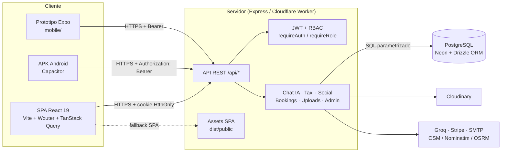
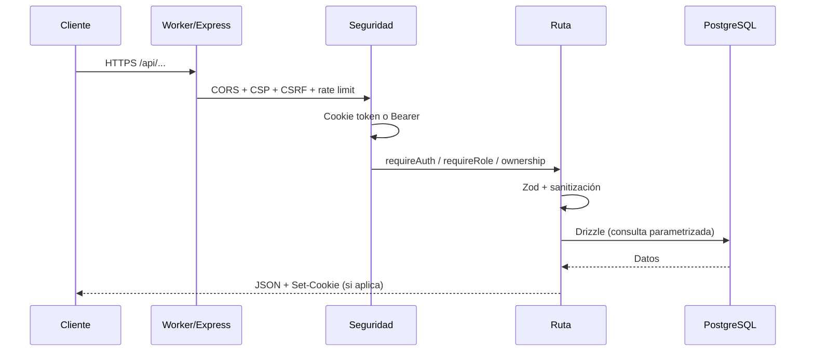

# ViaNovaIA

Plataforma full-stack de turismo y comercio local para Colombia. ViaNovaIA conecta viajeros con hoteles, restaurantes, experiencias de recreación, taxistas y traductores, e integra un asistente de viaje con IA, una red social, un marketplace con órdenes y paneles analíticos por rol.

El repositorio contiene una SPA React, una API Express ejecutable en Node.js o Cloudflare Workers, una base de datos PostgreSQL (Neon), una app Android empaquetada con Capacitor y un prototipo móvil independiente en Expo.

> Estado del documento: describe la implementación real del repositorio. Las limitaciones y brechas conocidas se indican explícitamente para que no se confundan con funcionalidad terminada.

---

## Índice

1. [Qué incluye la plataforma](#qué-incluye-la-plataforma)
2. [Stack tecnológico](#stack-tecnológico)
3. [Arquitectura](#arquitectura)
4. [Estructura del repositorio](#estructura-del-repositorio)
5. [Roles y permisos](#roles-y-permisos)
6. [Modelo de seguridad](#modelo-de-seguridad)
7. [Mapas y geolocalización](#mapas-y-geolocalización)
8. [Ejecución local](#ejecución-local)
9. [Variables de entorno](#variables-de-entorno)
10. [Scripts disponibles](#scripts-disponibles)
11. [API (resumen)](#api-resumen)
12. [Despliegue](#despliegue)
13. [Solución de problemas](#solución-de-problemas)
14. [Documentación y QA](#documentación-y-qa)
15. [Limitaciones conocidas](#limitaciones-conocidas)

---

## Qué incluye la plataforma

| Módulo | Descripción |
|---|---|
| Descubrimiento | Landing con categorías, búsqueda, filtros, mapa, comentarios, visor VR y recomendaciones. |
| Asistente IA | Chat contextual con Groq, memoria persistente por usuario, catálogo real de servicios/productos y copiloto de negocio. |
| Marketplace | Productos por rol proveedor, stock, imágenes, multimedia, órdenes, checkout Stripe opcional y reservas con bloqueo temporal. |
| Taxi | Solicitud de viaje, tarifa estimada, aceptación por taxista, seguimiento de estados, historial, ganancias y retiros. |
| ViaSocial | Publicaciones con imagen/video, likes, comentarios, follow, bloqueo, reportes y mensajes privados. |
| Paneles | Analíticas para viajero, proveedor y administrador; gestión de productos, servicios, pedidos y cuentas. |
| Cuenta | Registro local o Google, verificación de correo, 2FA, recuperación de contraseña, multi-rol, roles activos y eliminación de cuenta. |
| Móvil | APK Android vía Capacitor y app Expo separada para pruebas nativas. |

### Flujos principales

- **Viajero:** registro → selección de rol → explorar catálogo → comprar/reservar → solicitar taxi → calificar → ver historial.
- **Proveedor:** añadir rol de negocio → publicar servicio/producto → recibir solicitudes/órdenes → gestionar stock y estados → consultar analíticas.
- **Taxista:** activar disponibilidad → recibir solicitudes → aceptar → iniciar → completar → acumular ganancias → solicitar retiro.
- **Administrador:** supervisar usuarios, proveedores, cuentas bloqueadas y salud global del negocio.

---

## Stack tecnológico

### Frontend

- **React 19** + **TypeScript 5.6**
- **Vite 7** como bundler y servidor de desarrollo
- **Wouter** para rutas SPA
- **TanStack Query 5** para estado remoto, caché y reintentos
- **Zustand** para autenticación (`client/src/lib/auth.ts`)
- **Tailwind CSS 4**, Radix UI, componentes estilo shadcn/ui
- **Framer Motion**, **Recharts**, **Lucide React**
- **i18next / react-i18next** (`es`, `en`, `fr`, `pt`, `zh`)
- **next-themes** (`light`, `dark`, `sunset`, `ocean`, `forest`)
- **MapLibre GL JS** y **Leaflet** para mapas
- **Three.js / react-three-fiber** para escenas y visor 3D/VR

### Backend

- **Node.js 20+** con **Express 4** y **tsx** en desarrollo
- **Drizzle ORM 0.45** + **PostgreSQL** (driver `@neondatabase/serverless`)
- **Zod** + `drizzle-zod` para validación
- **JWT** (`jsonwebtoken`) + **bcryptjs**
- **express-rate-limit** con store opcional en Upstash Redis
- **Cloudinary** para imágenes/video, **Multer** para carga
- **Nodemailer** para correo transaccional
- **Stripe** para checkout/webhook opcional
- **Groq** para el asistente IA

### Infraestructura y móvil

- **Cloudflare Workers** (`wrangler.jsonc`, `server/worker.ts`) con assets estáticos y fallback SPA
- **Vercel** (`vercel.json`) con funciones en `api/`
- **Capacitor 8** para Android (`android/`)
- **Expo 54 / React Native 0.81** en `mobile/` (prototipo separado)

---

## Arquitectura



### Flujo de una petición



### Decisiones de arquitectura

- **Monolito modular:** una sola API Express agrupa auth, marketplace, taxi, social, reservas y analíticas. En Cloudflare se ejecuta mediante un adaptador Worker.
- **Servidor como fuente de verdad:** identidad, rol activo, propiedad de recursos, precios, stock y estados se validan en backend; el cliente nunca decide esos valores.
- **Base de datos relacional:** usuarios, roles, productos, órdenes, reservas, viajes, reseñas, pagos y mensajes comparten PostgreSQL.
- **Caché de cliente:** TanStack Query centraliza fetching, invalidación y reintentos. La sesión se hidrata contra `/api/auth/me` al iniciar.
- **Entrega multientorno:** el mismo código corre en Node (`server/index.ts`) y en Workers (`server/worker.ts`); los assets se sirven desde `dist/public`.

---

## Estructura del repositorio

```text
ViaNovaIA/
├─ client/
│  ├─ index.html
│  ├─ public/
│  │  ├─ sw.js                 # service worker de notificaciones push
│  │  └─ favicon.png
│  └─ src/
│     ├─ App.tsx               # rutas SPA
│     ├─ main.tsx
│     ├─ pages/
│     │  ├─ Home.tsx
│     │  ├─ Login.tsx
│     │  ├─ Dashboard.tsx
│     │  ├─ ProviderDashboard.tsx
│     │  ├─ AdminDashboard.tsx
│     │  ├─ ProductManager.tsx
│     │  ├─ ProductStore.tsx
│     │  ├─ MyProducts.tsx
│     │  ├─ SocialFeed.tsx
│     │  ├─ Messages.tsx
│     │  ├─ UserProfile.tsx
│     │  ├─ Notifications.tsx
│     │  ├─ AccountSettings.tsx
│     │  ├─ RoleSelection.tsx
│     │  ├─ RideHistory.tsx
│     │  ├─ Privacy.tsx
│     │  └─ taxi/
│     │     ├─ RequestRide.tsx
│     │     ├─ TaxiDashboard.tsx
│     │     ├─ RideDetail.tsx
│     │     ├─ TaxiEarnings.tsx
│     │     └─ ...
│     ├─ components/           # Navbar, Chatbot, MapView, TaxiOrderPanel,
│     │                        # PaymentMethods, ReviewSystem, ProviderCalendar,
│     │                        # componentes taxi, UI y multimedia
│     ├─ hooks/
│     ├─ lib/
│     │  ├─ auth.ts            # store Zustand + llamadas de sesión
│     │  ├─ queryClient.ts     # apiBase y configuración de queries
│     │  ├─ map-style.ts       # estilo MapLibre con tiles OSM
│     │  ├─ i18n.ts
│     │  └─ geo.ts
│     ├─ data/
│     └─ styles/
├─ server/
│  ├─ index.ts                 # arranque Node (puerto 5000 por defecto)
│  ├─ app.ts                   # Express, CSRF, JSON, errores
│  ├─ worker.ts                # entrada Cloudflare Workers
│  ├─ routes/
│  │  ├─ index.ts              # auth, usuarios, servicios, chat, productos,
│  │  │                        # órdenes, pagos, reseñas, admin, social
│  │  ├─ taxi.routes.ts        # viajes, disponibilidad, ganancias, retiros
│  │  ├─ bookings.routes.ts    # slots, lock temporal y confirmación
│  │  └─ social.routes.ts      # feed, likes, comentarios, follow, mensajes
│  ├─ security.ts              # JWT, cookies, RBAC, CSRF, cifrado
│  ├─ config.ts                # secretos y orígenes permitidos
│  ├─ http-security.ts         # CORS, CSP, cabeceras
│  ├─ rate-limits.ts           # límites por endpoint
│  ├─ storage.ts               # acceso Drizzle
│  ├─ taxi.storage.ts
│  ├─ analytics.ts             # métricas de dashboard
│  ├─ mailer.ts
│  ├─ upload-validation.ts
│  └─ static.ts / vite.ts
├─ shared/
│  ├─ schema.ts                # tablas y esquemas Zod principales
│  └─ taxi.schema.ts           # rides, earnings, withdrawals
├─ scripts/                    # migraciones, diagnósticos y smoke tests
├─ script/build.ts             # build de producción
├─ api/                        # funciones Vercel (index.ts, tts.py)
├─ mobile/                     # prototipo Expo independiente
├─ android/                    # proyecto nativo Capacitor
├─ assets/                     # recursos de marca
├─ dist/                       # build (generado)
├─ wrangler.jsonc              # configuración Cloudflare Workers
├─ vercel.json                 # configuración Vercel
├─ capacitor.config.ts
├─ drizzle.config.ts
└─ package.json
```

### Rutas SPA registradas

`/`, `/login`, `/select-role`, `/settings`, `/my-products`, `/notifications`, `/dashboard`, `/admin`, `/taxi-dashboard`, `/taxi/ride/:id`, `/taxi/earnings`, `/request-ride`, `/ride-history`, `/social`, `/messages`, `/u/:username`, `/privacy`, `/products`, `/explore`.

> `ProviderDashboard.tsx` existe, pero **no está registrado** en `client/src/App.tsx`. `MyProducts.tsx` tiene ruta `/my-products`, aunque el Navbar enlaza "Mis Productos" a `/products` (ProductManager). Ver [Limitaciones conocidas](#limitaciones-conocidas).

---

## Roles y permisos

Los roles válidos están definidos en `shared/schema.ts` (`user_role`) y `VALID_ROLES`.

| Rol | Valor | Alcance principal |
|---|---|---|
| Viajero | `traveler` | Explorar, comprar, reservar, pedir taxi, reseñar, social, chat. |
| Hotel | `hotel` | Servicios y productos de alojamiento, reservas, analíticas de negocio. |
| Restaurante | `restaurant` | Servicios/productos gastronómicos, pedidos, reservas. |
| Recreación | `recreation` | Experiencias, actividades y productos turísticos. |
| Taxi | `taxi` | Disponibilidad, viajes, ganancias y retiros. |
| Traductor | `translator` | Servicios de traducción/guía y productos asociados. |
| Administrador | `admin` | Acceso global, métricas, supervisión y soporte. |

### Reglas de rol

- El registro público **siempre crea `traveler`**.
- Un usuario puede tener varios roles en `user_roles`; el rol activo se guarda en `users.role`.
- `PATCH /api/users/role` cambia el rol y aplica un **cooldown de 15 días** (salvo admin).
- `PATCH /api/users/active-role` cambia el rol activo solo si el usuario ya posee ese rol.
- `POST /api/users/:username/roles` añade un rol; `DELETE .../roles/:role` lo elimina (no permite quedarse sin roles).
- El rol `admin` **no puede autoasignarse** desde registro, cambio de rol ni activación.
- La autorización de recursos se valida por rol **y** por propiedad (`requireSelfOrAdmin`, `isOwnerOrAdmin`).
- Los paneles de proveedor redirigen a viajeros/admin; `/admin` redirige a quien no sea admin.

---

## Modelo de seguridad

### Sesión y autenticación

- JWT firmado con `JWT_SECRET`; cookie `token` con `HttpOnly`, `SameSite=Lax`, `Secure` en producción y expiración de **120 minutos**.
- Clientes nativos pueden enviar `Authorization: Bearer <token>`; el backend acepta cookie **o** Bearer.
- `GET /api/auth/me` es opcional: devuelve `{ user: null }` para anónimos, sin generar 401 ruidosos.
- Logout revoca el `jti` en `revoked_tokens` y limpia la cookie.
- Bloqueo temporal tras **5 intentos fallidos** (15 minutos); 2FA por código de 6 dígitos con expiración de 10 minutos.
- Recuperación de contraseña con token de un solo uso, hash en base de datos y expiración de 15 minutos.
- Contraseñas con bcrypt; política de mínimo 8 caracteres, letras y números, bloqueo de contraseñas comunes.

### Autorización

- `requireAuth`: exige sesión válida.
- `optionalAuth`: hidrata el usuario si existe, pero permite continuar.
- `requireRole(...roles)`: restringe por rol activo.
- `requireSelfOrAdmin(...)`: restringe por username propio o admin.
- Comprobaciones de propiedad adicionales en servicios, productos, órdenes, reservas, viajes, reseñas, pagos y multimedia.

### CSRF, CORS y cabeceras

- Mutaciones protegidas por validación de `Origin`/`Referer` contra una allowlist (`CLIENT_URL`, `APP_URL`, `PUBLIC_URL`, `CORS_ALLOWED_ORIGINS`).
- Sin `Origin`/`Referer`, solo se permite Bearer o peticiones sin cookie; una cookie sin origen válido recibe **403**.
- Excepción: `POST /api/stripe/webhook` (se valida con firma de Stripe).
- CORS con `credentials: true`, allowlist explícita y métodos/headers acotados.
- CSP, `X-Frame-Options: DENY`, `X-Content-Type-Options: nosniff`, `Referrer-Policy`, `Permissions-Policy` y HSTS en producción.
- Límite de cuerpo JSON de 2 MB y `urlencoded` de 256 KB; respuestas 413 para excesos.

### Límites de tasa

| Limitador | Ventana | Máximo | Ámbito |
|---|---:|---:|---|
| `authLimiter` | 15 min | 10 | Login / Google |
| `registerLimiter` | 60 min | 5 | Registro por IP |
| `twoFactorLimiter` | 15 min | 5 | Verificación 2FA |
| `verifyEmailLimiter` | 15 min | 10 | Verificación de correo |
| `forgotPasswordLimiter` | 60 min | 5 | Solicitud de recuperación |
| `resetTokenLimiter` | 15 min | 10 | Token/reset |
| `uploadLimiter` | 60 min | 20 | Subidas |
| `chatLimiter` | 1 min | 20 | Chat IA |
| `writeLimiter` | 15 min | 60 | Escrituras generales |
| `bookingRequestLimiter` | 60 min | 10 | Solicitudes de reserva |
| `mapsLimiter` | 15 min | 30 | Resolución de mapas |
| `publicReadLimiter` | 15 min | 300 | Lecturas públicas |

Las respuestas 429 incluyen `Retry-After` y cabeceras `RateLimit`.

### Validación y datos sensibles

- Esquemas Zod en endpoints críticos; sanitización de texto, usernames, emails y URLs.
- Filtro de profanidad en chat, comentarios y publicaciones.
- Validación de archivos por MIME, extensión, tamaño y tipo real; rechazo con 415.
- URLs de avatar y multimedia validadas contra `http/https`; el resolver de Google Maps usa allowlist, timeout y bloqueo de redirecciones externas.
- Medios de pago: `details` se cifra con **AES-256-GCM** y se devuelve sanitizado (nunca el valor plano).
- Los logs de admin no exponen usernames.
- Variables sensibles solo por entorno; `.env`, `.dev.vars` y `vianova.env.txt` no deben versionarse.

---

## Mapas y geolocalización

- **MapLibre GL JS** usa un estilo raster de OpenStreetMap definido en `client/src/lib/map-style.ts`:
  - Tiles: `https://tile.openstreetmap.org/{z}/{x}/{y}.png`
  - Atribución obligatoria a OpenStreetMap.
  - **No requiere API key ni token de Mapbox.**
  - `client/src/lib/maplibre-worker.ts` importa el worker con `?url`; Vite lo emite como asset hasheado. No elimines ese import o MapLibre fallará con `Worker failed to load`.
- **Leaflet** se usa en `RequestRide.tsx` y `RideDetail.tsx`, también con tiles de OpenStreetMap.
- **Nominatim** se usa para geocodificar direcciones y **OSRM** para calcular rutas; ambos son servicios públicos con políticas de uso. Para producción de alto tráfico conviene un proveedor con SLA o un proxy propio.
- Si falla la geolocalización, la ruta o las coordenadas, la app ofrece abrir Google Maps como fallback.
- La CSP permite `img-src https:` y `connect-src https:` para tiles y APIs externas.

### Consideraciones

- OpenStreetMap no es un CDN ilimitado. Un pico de tráfico puede provocar bloqueos temporales (403/429) o tiles vacíos.
- No se debe añadir una API key de Mapbox: el stack actual no la usa.
- La disponibilidad del mapa depende de red, CSP y del proveedor de tiles, no de una clave del proyecto.

---

## Ejecución local

### Requisitos

- Node.js 20 o superior
- npm 10 o superior
- PostgreSQL accesible (Neon o instancia local)
- Opcional: Cloudflare Wrangler, Android Studio, Expo CLI

### Instalación

```bash
npm install
```

Crea un archivo `.env` (Node) o `.dev.vars` (Wrangler) con las variables de la sección siguiente. No uses valores de ejemplo en producción.

### Desarrollo web

```bash
npm run dev
```

- Levanta Express y Vite en modo middleware sobre el mismo puerto.
- URL por defecto: `http://localhost:5000` (o el valor de `PORT`).
- Incluye HMR de Vite.

Alternativa solo cliente:

```bash
npm run dev:client
```

- Vite en `http://localhost:5000`.
- Requiere que la API esté disponible por separado; revisa `apiBase` en `client/src/lib/queryClient.ts`.

### Verificación de tipos

```bash
npm run check
```

Ejecuta `tsc` sin emitir. Es el primer control antes de abrir un PR.

### Build y producción Node

```bash
npm run build
npm run start
```

- `build` genera el cliente y el bundle de servidor (`dist/index.cjs`).
- `start` ejecuta el servidor compilado en modo producción.

### Base de datos

```bash
npm run db:push
```

Sincroniza el esquema Drizzle con la base configurada en `DATABASE_URL`.

> El servidor ejecuta `assertSecurityConfig()` al arrancar. Si faltan `JWT_SECRET` o `SESSION_SECRET` (mínimo 32 caracteres), **no inicia**.

---

## Variables de entorno

Solo se listan nombres; los valores deben configurarse en el gestor de secretos o en archivos locales no versionados.

### Obligatorias

| Variable | Uso |
|---|---|
| `DATABASE_URL` | Cadena de conexión PostgreSQL/Neon. |
| `JWT_SECRET` | Firma de JWT (≥ 32 caracteres). |
| `SESSION_SECRET` | Firma de cookies de sesión (≥ 32 caracteres). |

### Aplicación y seguridad

| Variable | Uso |
|---|---|
| `NODE_ENV` | `development` o `production`. |
| `PORT` | Puerto del servidor Node (por defecto 5000). |
| `CLIENT_URL` | Origen del cliente para CORS/CSRF y retornos. |
| `APP_URL` | Origen público alternativo. |
| `PUBLIC_URL` | URL pública usada en enlaces de correo/OAuth. |
| `CORS_ALLOWED_ORIGINS` | Orígenes extra separados por coma. |
| `UPSTASH_REDIS_REST_URL` | Store distribuido de rate limiting (opcional). |
| `UPSTASH_REDIS_REST_TOKEN` | Token de Upstash (opcional). |

### Integraciones

| Variable | Uso |
|---|---|
| `CLOUDINARY_CLOUD_NAME` | Cloudinary. |
| `CLOUDINARY_API_KEY` | Cloudinary. |
| `CLOUDINARY_API_SECRET` | Cloudinary. |
| `GROQ_API_KEY` | Asistente IA. |
| `GROQ_MODEL` | Modelo Groq (opcional). |
| `GOOGLE_CLIENT_ID` | OAuth/ID token. |
| `GOOGLE_CLIENT_SECRET` | OAuth web. |
| `GOOGLE_REDIRECT_URI` | Callback OAuth (opcional). |
| `GOOGLE_MOBILE_CLIENT_ID` | ID token móvil (opcional). |
| `GOOGLE_ALLOWED_CLIENT_IDS` | Lista de client IDs permitidos (opcional). |
| `SMTP_HOST` / `SMTP_PORT` | Correo. |
| `SMTP_USER` / `SMTP_PASS` | Credenciales SMTP. |
| `SMTP_FROM` | Remitente. |
| `STRIPE_SECRET_KEY` | Checkout/webhook (opcional). |
| `STRIPE_WEBHOOK_SECRET` | Firma del webhook (opcional). |
| `VITE_NATIVE_API_BASE` | API base para builds nativos. |

> `CLIENT_URL` debe coincidir con el origen real del navegador. Un origen distinto provoca fallos de CORS y 403 por CSRF.

---

## Scripts disponibles

| Script | Acción |
|---|---|
| `npm run dev` | Express + Vite en desarrollo. |
| `npm run dev:client` | Solo Vite en el puerto 5000. |
| `npm run check` | TypeScript sin emisión. |
| `npm run build` | Build de producción Node. |
| `npm run start` | Sirve el build compilado. |
| `npm run db:push` | Sincroniza Drizzle con la base. |
| `npm run build:cloudflare` | Build de cliente + assets para Workers. |
| `npm run dev:cloudflare` | Wrangler en local. |
| `npm run deploy:cloudflare` | Build y despliegue a Cloudflare. |

`scripts/` contiene migraciones por fases y utilidades de diagnóstico/smoke tests. No son parte del runtime de producción.

---

## API (resumen)

Base: `/api`. Todas las respuestas son JSON salvo uploads y el webhook de Stripe.

### Autenticación y cuenta

| Método | Ruta | Acceso | Descripción |
|---|---|---|---|
| POST | `/auth/register` | Público (rate limit) | Crea cuenta `traveler`; exige términos. |
| POST | `/auth/login` | Público (rate limit) | Login por usuario o email; puede pedir 2FA. |
| POST | `/auth/verify-2fa` | Público (rate limit) | Verifica código y emite sesión. |
| POST | `/auth/logout` | Público | Revoca token y limpia cookie. |
| GET | `/auth/me` | Opcional | Usuario actual o `null`. |
| GET/PATCH | `/auth/2fa` | Autenticado | Consulta/activa 2FA (requiere contraseña). |
| POST | `/auth/verify-email` | Público | Verifica código de correo. |
| POST | `/auth/forgot-password` | Público | Envía código (respuesta genérica). |
| POST | `/auth/verify-reset-token` | Público | Valida token de recuperación. |
| POST | `/auth/reset-password` | Público | Cambia contraseña. |
| POST | `/auth/google/mobile` | Público | Login con ID token de Google. |
| GET | `/auth/google` | Público | OAuth web. |
| PATCH | `/user/profile` | Autenticado | Nombre, bio y avatar. |
| DELETE | `/user/account` | Autenticado | Eliminación de cuenta. |

### Usuarios, roles y admin

| Método | Ruta | Acceso | Descripción |
|---|---|---|---|
| GET | `/users/:username/roles` | Opcional | Roles del usuario. |
| POST | `/users/:username/roles` | Propio/admin | Añade rol y datos de negocio. |
| DELETE | `/users/:username/roles/:role` | Propio/admin | Elimina rol (no el último). |
| PATCH | `/users/active-role` | Autenticado | Cambia rol activo. |
| PATCH | `/users/role` | Propio/admin | Cambia rol con cooldown de 15 días. |
| PATCH | `/taxi/vehicle` | Taxi/admin | Tipo, placa y teléfono. |
| GET | `/users/:username/profile` | Público | Perfil público. |
| GET | `/admin/stats` | Admin | Usuarios, proveedores, bloqueos y anomalías. |
| GET | `/analytics/dashboard` | Autenticado | Métricas por rol y periodo. |

### Catálogo, productos y órdenes

| Método | Ruta | Acceso | Descripción |
|---|---|---|---|
| GET | `/services` | Público | Servicios por categoría (`category` obligatoria). |
| GET | `/services/provider/:username` | Público | Servicios de un proveedor. |
| POST/PATCH/DELETE | `/services`, `/services/:id` | Proveedor/admin | CRUD de servicios con ownership. |
| GET | `/products` | Público | Marketplace paginado por categoría. |
| GET | `/products/provider/:username` | Público | Productos del proveedor. |
| POST | `/products` | Proveedor | Crea producto (multipart, portada opcional). |
| PATCH/DELETE | `/products/:id` | Dueño/admin | Actualiza/elimina producto. |
| POST | `/products/:id/media` | Dueño/admin | Añade imagen, video, 360, 3D o tour. |
| DELETE | `/products/:id/media/:assetId` | Dueño/admin | Elimina multimedia. |
| POST | `/orders` | Autenticado | Reserva stock de forma atómica; idempotencia opcional. |
| GET | `/orders/buyer/:username` | Propio/admin | Órdenes del comprador. |
| GET | `/orders/provider/:username` | Propio/admin | Órdenes del proveedor. |
| PATCH | `/orders/:id/status` | Comprador/proveedor/admin | Transiciones y reposición de stock. |
| POST | `/stripe/create-checkout-session` | Público | Checkout Stripe (si está configurado). |
| POST | `/stripe/webhook` | Stripe | Crea orden pagada tras el evento. |

### Reservas, pagos, reseñas y chat

| Método | Ruta | Acceso | Descripción |
|---|---|---|---|
| POST | `/bookings/slots` | Autenticado | Crea disponibilidad. |
| GET | `/bookings/slots/:serviceId` | Público | Slots disponibles. |
| POST | `/bookings/lock` | Autenticado | Bloqueo atómico por 5 minutos. |
| POST | `/bookings/confirm` | Dueño/admin | Confirma reserva (PSE pendiente). |
| POST | `/bookings/request` | Autenticado | Solicitudes del chatbot + notificación/email. |
| GET | `/payment-methods/:username` | Propio/admin | Métodos sanitizados. |
| POST | `/payment-methods` | Autenticado | Añade método (detalles cifrados). |
| DELETE | `/payment-methods/:id` | Dueño | Elimina método. |
| PATCH | `/payment-methods/:id/default` | Dueño | Marca predeterminado. |
| POST | `/reviews` | Autenticado | Reseña de viaje completado. |
| GET | `/reviews/:username` | Público | Reseñas y promedio. |
| GET | `/reviews/ride/:rideId` | Participante/admin | Reseñas de un viaje. |
| GET | `/chat/history` | Autenticado | Historial del asistente. |
| POST | `/chat` | Autenticado (rate limit) | Mensaje al asistente IA. |
| POST | `/upload` | Autenticado | Subida validada a Cloudinary. |
| GET | `/maps/resolve` | Autenticado | Resuelve enlaces de Google Maps con allowlist. |

### Taxi

| Método | Ruta | Acceso | Descripción |
|---|---|---|---|
| POST | `/rides` | Autenticado | Crea solicitud de viaje. |
| GET | `/rides/nearby` | Taxi/admin | Solicitudes pendientes. |
| GET | `/rides/:id` | Participante/admin | Detalle del viaje. |
| PATCH | `/rides/:id` | Participante/admin | Transiciones `pending → accepted → in_progress → completed` o `cancelled`. |
| GET | `/rides/taxi/:username` | Propio/admin | Viaje activo e historial del taxista. |
| GET | `/rides/traveler/:username` | Propio/admin | Viaje activo e historial del viajero. |
| PATCH | `/taxi/status` | Taxi/admin | Disponibilidad y coordenadas. |
| GET | `/taxi/nearby` | Autenticado | Taxistas disponibles (datos públicos). |
| GET | `/taxi/profile/:username` | Autenticado | Perfil propio completo; público sin placa/teléfono. |
| GET | `/taxi/earnings/:username` | Propio/admin | Ganancias, retiros y saldo. |
| POST | `/taxi/withdraw` | Taxi/admin | Solicitud de retiro con validación de saldo. |

### Social y mensajes

| Método | Ruta | Acceso | Descripción |
|---|---|---|---|
| GET | `/social/posts` | Público | Feed con paginación y bloqueos. |
| POST | `/social/posts` | Autenticado | Publicación con texto/media. |
| DELETE | `/social/posts/:postId` | Autor | Elimina publicación propia. |
| POST/DELETE | `/social/posts/:postId/like` | Autenticado | Like/unlike. |
| GET | `/social/posts/:postId/likes/check` | Público | Comprueba like. |
| GET/POST | `/social/posts/:postId/comments` | Público/Autenticado | Comentarios. |
| POST/DELETE | `/social/follow` | Autenticado | Seguir/dejar de seguir. |
| GET | `/social/follow/status` | Público | Estado de follow. |
| POST/DELETE | `/social/block` | Autenticado | Bloquear/desbloquear. |
| POST | `/social/report` | Autenticado | Reportar usuario. |
| GET | `/social/users/:username/profile` | Público | Perfil social. |
| GET | `/social/users/:username/posts` | Público | Publicaciones del usuario. |
| GET | `/social/messages/conversations` | Autenticado | Conversaciones. |
| GET | `/social/messages/unread/count` | Autenticado | No leídos. |
| GET | `/social/messages/:otherUsername` | Autenticado | Mensajes con un usuario. |
| POST | `/social/messages` | Autenticado | Enviar mensaje. |
| GET | `/health` | Público | Healthcheck. |

> No existe una ruta `GET /api/social/feed`. El feed de la SPA usa `GET /api/social/posts`, servido por el router montado en `/api/social`.

### Notificaciones

| Método | Ruta | Acceso | Descripción |
|---|---|---|---|
| GET | `/notifications` | Autenticado | Notificaciones del usuario derivadas del token (proveedor o viajero). Devuelve un arreglo. |
| PATCH | `/notifications/:id/read` | Autenticado | Marca como leída una notificación propia; admin puede marcar cualquiera. Responde `{ "success": true }` o `404`. |

---

## Despliegue

### Cloudflare Workers

Configuración en `wrangler.jsonc`:

- `main`: `server/worker.ts`
- `compatibility_date`: `2026-10-20`
- `compatibility_flags`: `nodejs_compat`
- Assets: `./dist/public`
- Fallback SPA: `single-page-application`
- `run_worker_first`: `/api`, `/api/*`
- Observabilidad activada

Comandos:

```bash
npm run build:cloudflare
npm run dev:cloudflare
npm run deploy:cloudflare
```

Los secretos se cargan con `wrangler secret put <NOMBRE>` (nunca en `wrangler.jsonc`). La base debe ser accesible por HTTP (Neon serverless).

### Vercel

`vercel.json` define:

- Build: `npm run build`
- Salida estática: `dist/public`
- `/api/tts` → `api/tts.py`
- `/api/*` → `api/index.ts`
- Resto → `index.html` (SPA)

Configura las variables de entorno en el panel de Vercel. El proyecto usa el mismo backend Express a través de la función de `api/index.ts`.

### Android / Capacitor

```bash
npm run build
npx cap sync android
npx cap open android
```

- `capacitor.config.ts`: appId `com.vianova.app`, `webDir: dist/public`, `CapacitorHttp` habilitado.
- El APK usa la API nativa con `VITE_NATIVE_API_BASE` y `Authorization: Bearer`.
- `android/` contiene el proyecto Gradle; `mobile/` es un prototipo Expo separado y no se empaqueta con Capacitor.

### Orden recomendado de despliegue

1. Configurar PostgreSQL y ejecutar `npm run db:push` (o migraciones controladas).
2. Cargar secretos (`JWT_SECRET`, `SESSION_SECRET`, `DATABASE_URL`, integraciones).
3. Definir `CLIENT_URL`/`PUBLIC_URL` con el dominio final.
4. `npm run check` y `npm run build`.
5. Desplegar Worker o Vercel.
6. Verificar `/api/health`, login, cookies y un flujo de lectura/escritura.

---

## Solución de problemas

### El mapa aparece gris, vacío o sin tiles

- Verifica que `https://tile.openstreetmap.org/{z}/{x}/{y}.png` responda desde tu red.
- Revisa la consola: errores CSP de `img-src` o `connect-src`, o bloqueo por extensión.
- OpenStreetMap puede devolver 403/429 por uso intensivo; prueba otra red o espera.
- No hace falta API key. Si configuraste una clave de Mapbox, no se usa en `map-style.ts`.
- En `RequestRide`/`RideDetail`, confirma que Leaflet cargó su CSS y que las coordenadas son válidas.
- Si el fallback a Google Maps funciona, el problema está en tiles/OSRM, no en la geolocalización.

### Pantalla oscura o tema incorrecto

- `next-themes` guarda la preferencia en `localStorage` (clave `theme`) y aplica la clase al `<html>`.
- Cambia el tema desde el Navbar (Sol/Luna) o limpia `localStorage` y recarga.
- El tema por defecto es `light`; `enableSystem` está desactivado.
- Si solo el Navbar cambia, revisa que el logo del tema exista en `client/src/assets`.
- Un fondo negro en un contenedor de mapa puede ser el tema oscuro o el placeholder de Leaflet mientras carga.

### 401 persistente o sesión que no se mantiene

- Comprueba que el navegador acepte la cookie `token` (HttpOnly, SameSite=Lax).
- `CLIENT_URL` debe coincidir exactamente con el origen (esquema, host y puerto).
- Peticiones cross-origin necesitan `credentials: 'include'` y CORS con `credentials: true`.
- La sesión expira a los 120 minutos; vuelve a iniciar sesión.
- Si el APK falla, usa `Authorization: Bearer` y revisa `VITE_NATIVE_API_BASE`.
- Un `user` obsoleto en `localStorage` puede mostrar UI autenticada sin cookie válida: cierra sesión y recarga.
- Tras cambiar de rol, algunas rutas responderán 403 hasta que el rol activo coincida.

### 403 "Origen no permitido" o "Falta validación de origen"

- Añade el origen exacto a `CLIENT_URL`/`CORS_ALLOWED_ORIGINS`.
- No envíes cookies desde orígenes no listados.
- En clientes nativos, usa Bearer en lugar de cookie.

### 429 por rate limit

- Espera la ventana indicada en `Retry-After`.
- Revisa si hay un proxy que comparte IP entre usuarios.
- Configura Upstash para límites distribuidos en Workers.

### Registro rechazado aunque la UI indique 6 caracteres

- El cliente valida mínimo 6, pero el servidor exige **8+ con letras y números** y bloquea contraseñas comunes.
- Usa una contraseña que cumpla la política del servidor.

### Notificaciones vacías o error al marcarlas como leídas

- La UI llama a `GET /api/notifications` y `PATCH /api/notifications/:id/read`.
- Esas rutas **no están registradas** en `server/routes`; solo existen la tabla y funciones de storage.
- Es una brecha conocida, no un fallo de sesión.

### El servidor no arranca

- Error típico: falta `JWT_SECRET` o `SESSION_SECRET`, o tienen menos de 32 caracteres.
- Verifica `DATABASE_URL` y conectividad.
- En Cloudflare, revisa `wrangler tail` y que los secretos estén cargados en el entorno correcto.

### `npm run dev` no sirve la API esperada

- `npm run dev` usa el puerto 5000 por defecto; `PORT` puede cambiarlo.
- `npm run dev:client` solo levanta Vite y no el backend.
- Comprueba `apiBase` en `client/src/lib/queryClient.ts`.

---

## Documentación y QA

| Documento | Ubicación | Estado |
|---|---|---|
| README técnico | `README.md` | Actualizado; describe arquitectura, seguridad, API y operación. |
| Informe de QA y seguridad | `INFORME_QA_SEGURIDAD_VIANOVA.md` | Documento de hallazgos y contexto de auditoría. |
| Checklist de remediación | `CHECKLIST_REMEDIACION_SEGURIDAD_VIANOVA.md` | Seguimiento de acciones de seguridad. |
| Checklist QA front/back | `docs/CHECKLIST_QA_VIANOVA.md` | Nuevo; cubre UI, endpoints, integración, E2E y rendimiento. |
| Despliegue Cloudflare | `CLOUDFLARE_DEPLOY.md` | Guía específica de despliegue. |
| Notas históricas | `CAMBIOS_ASTRA6.MD`, `Errores.md`, `plan_implementacion.txt` | Contexto de evolución; no son especificación vigente. |

### Cómo reportar un hallazgo

Incluye:

1. Entorno (local, Worker, Vercel, APK) y rol activo.
2. Ruta o endpoint exacto.
3. Pasos reproducibles.
4. Resultado esperado vs. observado.
5. Evidencia (status HTTP, mensaje, consola, captura).
6. Si aplica, impacto de seguridad y datos afectados.

No adjuntes secretos, tokens, contraseñas ni datos personales en capturas o issues.

---

## Limitaciones conocidas

Estas brechas están presentes en el código y deben considerarse al planificar QA o producción:

- **Notificaciones:** las rutas `GET /api/notifications` y `PATCH /api/notifications/:id/read` ya existen; la campana del Navbar solo se muestra para roles proveedor distintos de viajero y admin, aunque la página `/notifications` funciona para cualquier usuario autenticado.
- **ProviderDashboard:** componente completo sin ruta en `App.tsx`; no es accesible por URL.
- **MyProducts vs ProductManager:** `/my-products` existe, pero el Navbar lleva a `/products`; hay dos experiencias de gestión con contratos distintos.
- **Social:** el router activo vive en `server/routes/social.routes.ts`; el feed se obtiene con `GET /api/social/posts` (no existe `/api/social/feed`).
- **Pagos PSE simulados:** la confirmación de reservas no cobra realmente; Stripe es opcional y su webhook crea órdenes sin reservar stock atómicamente.
- **Mapas:** OSM/Nominatim/OSRM son servicios públicos sin SLA; no aptos para tráfico alto sin proxy o proveedor dedicado.
- **Rutas no lazy:** `App.tsx` importa todas las páginas de forma eager; el bundle inicial puede crecer.
- **PWA parcial:** hay service worker de push, pero no manifest ni estrategia offline completa.
- **i18n parcial:** existen cinco idiomas, pero no todas las cadenas están traducidas.
- **Datos mock:** `RideHistory` inserta reservas de ejemplo para viajeros; no son datos reales.
- **Analytics admin:** el endpoint ya no devuelve usernames, pero la UI todavía intenta mostrar `log.username`.

Para el detalle de pruebas, usa `docs/CHECKLIST_QA_VIANOVA.md`.
