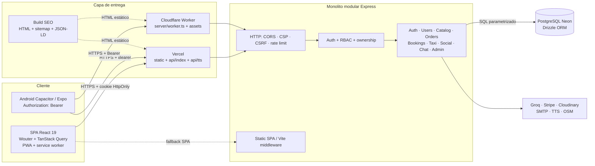
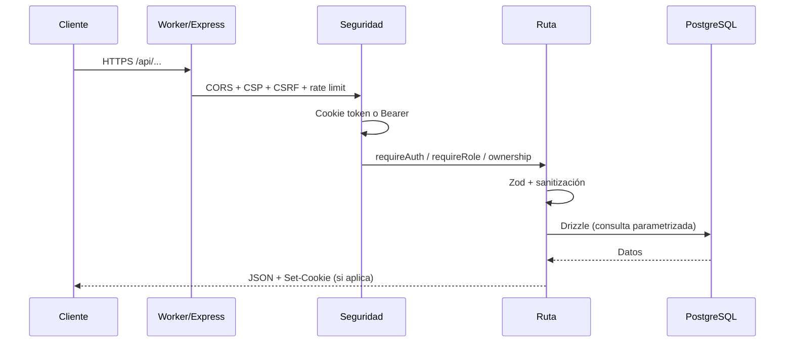

# ViaNovaIA

Plataforma full-stack de turismo y comercio local para Colombia. ViaNovaIA conecta viajeros con hoteles, restaurantes, experiencias de recreación, taxistas y traductores, e integra un asistente de viaje con IA, una red social, un marketplace con órdenes y paneles analíticos por rol.

El repositorio contiene una SPA React, una API Express ejecutable en Node.js o Cloudflare Workers, una base de datos PostgreSQL (Neon), una app Android empaquetada con Capacitor y un prototipo móvil independiente en Expo.

> Estado del documento: describe la implementación real del repositorio al **27 de octubre de 2026**. Las limitaciones y brechas conocidas se indican explícitamente para que no se confundan con funcionalidad terminada.

> **Resumen de estado:** MVP funcional y desplegado. La web/PWA, la API, el login local y con Google, el marketplace, las reservas, el taxi, el social y la capa SEO están operativos. Pagos PSE, offline de escrituras y publicación en tiendas siguen siendo prototipo o trabajo pendiente.

---

## Índice

1. [Capacidades actuales](#capacidades-actuales)
2. [Estado del prototipo](#estado-del-prototipo)
3. [Stack tecnológico](#stack-tecnológico)
4. [Arquitectura](#arquitectura)
5. [Diseño y experiencia](#diseño-y-experiencia)
6. [Estructura del repositorio](#estructura-del-repositorio)
7. [Roles y permisos](#roles-y-permisos)
8. [Modelo de seguridad](#modelo-de-seguridad)
9. [Mapas y geolocalización](#mapas-y-geolocalización)
10. [Ejecución local](#ejecución-local)
11. [Variables de entorno](#variables-de-entorno)
12. [Scripts disponibles](#scripts-disponibles)
13. [API (resumen)](#api-resumen)
14. [Despliegue](#despliegue)
15. [Cobertura y verificación](#cobertura-y-verificación)
16. [Solución de problemas](#solución-de-problemas)
17. [Documentación y QA](#documentación-y-qa)
18. [Limitaciones conocidas](#limitaciones-conocidas)
19. [Próximamente](#próximamente)
20. [Aspiración del prototipo](#aspiración-del-prototipo)

---

## Capacidades actuales

| Módulo | Estado | Descripción |
|---|---|---|
| Descubrimiento | Operativo | Landing con categorías, búsqueda, filtros, mapa, comentarios, visor VR/360/3D y recomendaciones. |
| Asistente IA | Operativo | Chat contextual con Groq, memoria persistente por usuario, catálogo real de servicios/productos y copiloto de negocio. |
| Marketplace | Operativo con límites | Productos por rol proveedor, stock, imágenes, multimedia, órdenes, checkout Stripe opcional y reservas con bloqueo temporal. |
| Taxi | Operativo con límites | Solicitud, tarifa estimada, aceptación, seguimiento de estados, historial, ganancias y retiros. No hay pasarela de pago real. |
| ViaSocial | Operativo | Publicaciones con imagen/video, likes, comentarios, follow, bloqueo, reportes y mensajes privados. |
| Paneles | Operativo | Analíticas para viajero, proveedor y administrador; gestión de productos, servicios, pedidos y cuentas. |
| Cuenta | Operativo | Registro local o Google, verificación de correo, 2FA, recuperación de contraseña, multi-rol, roles activos y eliminación de cuenta. |
| SEO técnico | Operativo | 4 guías prerenderizadas, metadatos por ruta, JSON-LD, `robots.txt`, `sitemap.xml`, `llms.txt`, canonical único y `noindex` en rutas privadas. |
| PWA | Parcial | Instalable, push y shell offline de assets. No hay cola de mutaciones ni datos privados disponibles sin red. |
| Voz (TTS) | Operativo | Función serverless `api/tts.py` con Edge TTS, JWT y lista blanca de voces. |
| Móvil | Prototipo | APK Android vía Capacitor y app Expo separada para pruebas nativas. Sin publicación en tiendas. |

### Flujos principales

- **Viajero:** registro → selección de rol → explorar catálogo → comprar/reservar → solicitar taxi → calificar → ver historial.
- **Proveedor:** añadir rol de negocio → publicar servicio/producto → recibir solicitudes/órdenes → gestionar stock y estados → consultar analíticas.
- **Taxista:** activar disponibilidad → recibir solicitudes → aceptar → iniciar → completar → acumular ganancias → solicitar retiro.
- **Administrador:** supervisar usuarios, proveedores, cuentas bloqueadas y salud global del negocio.

---

## Estado del prototipo

Corte: **27 de octubre de 2026**. Escala usada: **Operativo** = flujo principal usable y verificado; **Parcial** = funciona con límites explícitos; **Prototipo** = validación técnica, todavía no listo para producción.

| Dimensión | Estado | Detalle |
|---|---|---|
| Web / PWA | Operativo | SPA React desplegada en Vercel, espejo en Cloudflare Workers, instalable, push y shell offline. |
| API | Operativo | Express ejecutado en Node, Vercel (`api/index`) y Cloudflare Worker. Misma lógica de dominio y seguridad. |
| Autenticación | Operativo | Registro local, login con Google web/móvil, verificación de correo, 2FA y recuperación. Callback local documentado en `http://localhost:5000/api/auth/google`. |
| Marketplace | Operativo con límites | CRUD de productos, stock atómico, órdenes y multimedia. Stripe es opcional; sin claves configuradas no hay cobro real. |
| Reservas | Operativo con límites | Slots, bloqueo temporal de 5 minutos y solicitud al proveedor. La confirmación PSE es simulada. |
| Taxi | Operativo con límites | Ciclo completo de viaje, disponibilidad, ganancias y retiros. No hay integración con pagos ni centrales de despacho reales. |
| Social | Operativo | Feed, likes, comentarios, follow, bloqueos, reportes y mensajería privada. |
| Asistente IA | Operativo con dependencia externa | Groq aporta el modelo; si falta cuota o clave, el chat no responde. |
| Admin y analíticas | Operativo | Métricas por rol, supervisión de cuentas y moderación básica. |
| SEO técnico | Operativo; verificación manual pendiente | HTML prerenderizado, JSON-LD, canonical único, `sitemap.xml`, `robots.txt`, `llms.txt` y envío IndexNow. Falta pulsar “Verificar” en Google Search Console y Bing Webmaster Tools. |
| Offline | Parcial | El service worker cachea el shell y assets; las APIs y las escrituras siguen requiriendo red. |
| Android | Prototipo | Proyecto Capacitor configurado. Sin APK firmado ni publicación en Play Store. |
| Expo | Prototipo separado | App de validación en `mobile/`; no se empaqueta con Capacitor. |
| Calidad | Cobertura inicial | `tsc` sin errores y 22 pruebas automatizadas. No hay suite E2E continua ni pruebas de carga. |
| Operación | MVP | Logs de plataforma, healthcheck y rate limiting. Sin APM, alertas ni SLA dedicado. |

**Lectura correcta:** esto es un MVP avanzado, no un producto transaccional cerrado. Antes de operar con dinero real o tráfico alto hay que resolver pagos, offline de escrituras, observabilidad y autoridad de dominio.

---

## Stack tecnológico

### Frontend

- **React 19** + **TypeScript 5.6**
- **Vite 7** como bundler y servidor de desarrollo
- **Wouter** para rutas SPA
- **TanStack Query 5** para estado remoto, caché y reintentos
- **Zustand** para autenticación (`client/src/lib/auth.ts`)
- **Tailwind CSS 4**, Radix UI, componentes estilo shadcn/ui
- **Framer Motion**, **Recharts**, **Lucide React**
- **i18next / react-i18next** (`es`, `en`, `fr`, `pt`, `zh`)
- **next-themes** (`light`, `dark`, `sunset`, `ocean`, `forest`)
- **MapLibre GL JS** y **Leaflet** para mapas
- **Three.js / react-three-fiber** para escenas y visor 3D/VR

### Backend

- **Node.js 20+** con **Express 4** y **tsx** en desarrollo
- **Drizzle ORM 0.45** + **PostgreSQL** (driver `@neondatabase/serverless`)
- **Zod** + `drizzle-zod` para validación
- **JWT** (`jsonwebtoken`) + **bcryptjs**
- **express-rate-limit** con store opcional en Upstash Redis
- **Cloudinary** para imágenes/video, **Multer** para carga
- **Nodemailer** para correo transaccional
- **Stripe** para checkout/webhook opcional
- **Groq** para el asistente IA

### Infraestructura y móvil

- **Cloudflare Workers** (`wrangler.jsonc`, `server/worker.ts`) con assets estáticos y fallback SPA
- **Vercel** (`vercel.json`) con funciones en `api/`
- **Capacitor 8** para Android (`android/`)
- **Expo 54 / React Native 0.81** en `mobile/` (prototipo separado)
- **Capa SEO de build:** `shared/seo-content.ts` + `vite-plugin-seo-pages.ts` generan HTML prerenderizado, metadatos y `sitemap.xml`
- **PWA:** `client/public/manifest.json` + `client/public/sw.js` (shell offline, cache de assets y push)

### Integraciones externas

| Integración | Uso | Estado |
|---|---|---|
| Google OAuth | Login web y validación de ID token móvil. | Configurado; callback local `http://localhost:5000/api/auth/google`. |
| Groq | Asistente IA y copiloto de negocio. | Requiere `GROQ_API_KEY`. |
| Stripe | Checkout y webhook de órdenes. | Opcional; sin claves no hay cobro. |
| Cloudinary | Imágenes, video, 360 y modelos 3D. | Requiere credenciales. |
| SMTP / Nodemailer | Verificación, recuperación y avisos de reserva. | Requiere servidor SMTP. |
| Edge TTS | Voz en español, inglés, francés, portugués y chino. | `api/tts.py`; JWT y voces en lista blanca. |
| Google Search Console | Verificación y envío de sitemap. | Etiqueta inyectada; verificación manual pendiente. |
| Bing Webmaster + IndexNow | Verificación y aviso de URLs nuevas. | Etiqueta inyectada; `npm run indexnow` operativo. |
| OpenStreetMap / Nominatim / OSRM | Tiles, geocodificación y rutas. | Servicios públicos sin SLA. |
| Upstash Redis | Rate limiting distribuido. | Opcional. |
| Vercel / Cloudflare | Despliegue de la SPA, API y funciones serverless. | Ambos dominios activos. |

---

## Arquitectura

ViaNovaIA es una **SPA React con un monolito modular Express** que se ejecuta en tres entornos: Node.js, Vercel Serverless y Cloudflare Workers. La base de datos es PostgreSQL (Neon) y el cliente habla con la API por HTTPS. La capa SEO se genera en tiempo de build, no en el navegador.

### Vista de capas

| Capa | Componentes principales | Responsabilidad |
|---|---|---|
| Presentación | React 19, Wouter, TanStack Query, Zustand, Tailwind 4, Radix, Framer Motion | Rutas SPA, estado remoto, sesión, formularios, mapas y visores multimedia. |
| Entrega | Vite, `dist/public`, Vercel, Cloudflare Worker, Capacitor | Servir assets, fallback SPA, funciones serverless y empaquetado nativo. |
| API | Express 4, `server/routes/*`, middlewares de seguridad | Validar entrada, autenticar, autorizar, orquestar dominio y responder JSON. |
| Dominio y datos | Drizzle ORM, `server/storage.ts`, `server/taxi.storage.ts`, PostgreSQL | Consultas parametrizadas, stock atómico, locks de reserva y persistencia. |
| Integraciones | Groq, Stripe, Cloudinary, SMTP, Edge TTS, OSM/Nominatim/OSRM | IA, pagos, medios, correo, voz y geolocalización. |
| Build SEO | `shared/seo-content.ts`, `vite-plugin-seo-pages.ts` | Generar HTML prerenderizado, JSON-LD, metadatos y `sitemap.xml`. |

### Topología de ejecución



### Topología por entorno

| Entorno | Entrada | Particularidad |
|---|---|---|
| Desarrollo | `server/index.ts` | Express + Vite middleware en el mismo puerto (`5000` por defecto) con HMR. |
| Node producción | `dist/index.cjs` | Express sirve la API y los assets compilados de `dist/public`. |
| Vercel | `api/index.ts` | Express envuelto como función; `/api/*` se reescribe a `/api/index` y `/api/tts` a `api/tts.py`. |
| Cloudflare | `server/worker.ts` | Adaptador Worker; `run_worker_first` para `/api` y assets con fallback SPA. |
| Android | Capacitor | Web build empaquetado; usa `VITE_NATIVE_API_BASE` y Bearer. |
| Expo | `mobile/` | Prototipo independiente; no comparte el empaquetado Capacitor. |

> En Vercel, `cleanUrls: true` obliga a que los destinos de rewrite no lleven extensión. Un destino `/api/index.ts` cae en el catch-all de la SPA y devuelve HTML. El test `tests/deploy-config.test.ts` protege esta regla.

### Flujo de una petición



### Módulos del backend

- `server/routes/index.ts`: autenticación, usuarios, roles, catálogo, productos, órdenes, pagos, reseñas, chat, admin, notificaciones, uploads y mapas.
- `server/routes/taxi.routes.ts`: viajes, disponibilidad, ganancias y retiros.
- `server/routes/bookings.routes.ts`: slots, locks temporales, confirmación y solicitudes.
- `server/routes/social.routes.ts`: feed, likes, comentarios, follow, bloqueos, reportes y mensajes.
- `server/storage.ts` y `server/taxi.storage.ts`: acceso a datos y operaciones atómicas.
- `server/security.ts`, `config.ts`, `http-security.ts`, `rate-limits.ts`: autenticación, RBAC, CSRF, cifrado y límites.
- `shared/schema.ts` y `shared/taxi.schema.ts`: tablas, relaciones y validaciones compartidas.

### Pipeline SEO de build

1. `shared/seo-content.ts` es la fuente única: dominio canónico, guías, metadatos, FAQs, enlaces internos y generadores JSON-LD.
2. `vite-plugin-seo-pages.ts` corre en `closeBundle`, lee `dist/public/index.html` y escribe un `.html` por guía con `<title>`, canonical, Open Graph, Twitter Cards, JSON-LD y contenido visible sin JavaScript.
3. El mismo plugin regenera `sitemap.xml` con la fecha del build e inyecta las etiquetas de verificación de Google y Bing.
4. `client/src/hooks/useSeo.ts` actualiza los metadatos al navegar dentro de la SPA; las rutas privadas reciben `X-Robots-Tag: noindex, nofollow` desde Vercel y Cloudflare.
5. El HTML estático y el render React muestran el mismo contenido: no hay cloaking.

### PWA y entrega offline

- `client/public/manifest.json`: instalación, iconos, shortcuts y modo `standalone`.
- `client/public/sw.js`: precache del shell, navegación network-first con fallback cacheado, cache de assets estáticos y push.
- **Nunca** se cachean `/api/` ni respuestas autenticadas.
- El offline actual cubre lectura del shell y assets; **no** cubre escrituras ni datos privados. La cola de mutaciones es trabajo futuro.

### Decisiones de arquitectura

- **Monolito modular:** una sola API agrupa auth, marketplace, taxi, social, reservas y analíticas. En Cloudflare se ejecuta mediante un adaptador Worker.
- **Servidor como fuente de verdad:** identidad, rol activo, propiedad de recursos, precios, stock y estados se validan en backend; el cliente nunca decide esos valores.
- **Base de datos relacional:** usuarios, roles, productos, órdenes, reservas, viajes, reseñas, pagos y mensajes comparten PostgreSQL.
- **Operaciones atómicas:** el stock de órdenes y los locks de reserva se resuelven con SQL transaccional, no con estado del cliente.
- **Sesión same-origin:** web usa cookie `HttpOnly`; nativo usa Bearer. La sesión se hidrata contra `/api/auth/me`.
- **Caché de cliente:** TanStack Query centraliza fetching, invalidación y reintentos.
- **Entrega multientorno:** el mismo código corre en Node y Workers; los assets se sirven desde `dist/public`.
- **SEO en build:** el contenido público se prerenderiza para que los buscadores lo vean sin ejecutar React.
- **Seguridad por defecto:** validación Zod, sanitización, rate limiting, CSRF, CSP y cifrado de datos de pago.

---

## Diseño y experiencia

### Sistema visual

- **Marca:** acento amarillo `#ffbf00`, fondos cálidos (`#f5f4f0` en claro, `#0b0b0c` en oscuro) y superficies blancas con bordes suaves.
- **Tipografía:** Inter para texto y Poppins para títulos, definidas como tokens en `client/src/index.css`.
- **Tokens semánticos:** color, radio, sombra, tipografía y estados (`success`, `warning`, `info`, `destructive`) se declaran en CSS y se consumen vía Tailwind/shadcn. No hay colores hardcodeados en cada página.
- **Temas:** `next-themes` con cinco variantes: `light` (por defecto), `dark`, `sunset`, `ocean` y `forest`. El tema se guarda en `localStorage` y se aplica como clase en `<html>`.
- **Componentes:** Radix UI + shadcn/ui en `client/src/components/ui`; patrones de tarjeta, diálogo, tabs, formularios y navegación reutilizables.

### Liquid Glass

`client/src/styles/glass.css` define el lenguaje de superficies:

- Tokens `--glass-bg`, `--glass-border`, `--glass-shadow`, `--glass-blur` y `--glass-highlight`.
- Capas de **blur + saturación**, borde translúcido, brillo interior y una textura de ruido sutil para dar profundidad.
- Variantes `liquid-glass`, `liquid-glass--strong` y `liquid-glass--hover` para tarjetas, paneles y contenedores.
- `prefers-reduced-motion` desactiva las transiciones no esenciales y `hover: none` evita transformaciones en pantallas táctiles.

### Movimiento y respuesta

- Framer Motion para entradas, transiciones y estados; las animaciones de glass usan una curva corta (`200ms cubic-bezier(0.23, 1, 0.32, 1)`) para no bloquear la interacción.
- Estados de carga con skeletons/spinners, estados vacíos explícitos y feedback de error en formularios.
- Layout responsive con Tailwind: navegación adaptativa, grillas que colapsan a una columna y controles de mapa/tarjetas dimensionados para móvil.

### Accesibilidad

- Base Radix: navegación por teclado, foco visible y roles ARIA en diálogos, menús, tabs y selectores.
- Etiquetas `aria-label` en acciones icónicas (notificaciones, tema, menú) y textos alternativos en imágenes.
- Token `--primary-ink` para texto dorado con contraste legible sobre fondos claros.
- Respeto de `prefers-reduced-motion` en el sistema de glass.
- **Pendiente:** no se ha ejecutado una auditoría WCAG formal ni pruebas con lector de pantalla en todos los flujos.

### Medios y guías

- `Viewer360`, `Viewer3D` y `VRViewer` cubren fotos 360, modelos 3D y experiencias inmersivas; `MediaGallery` unifica la presentación.
- Las guías SEO usan un layout editorial propio, con tabla de contenidos, FAQs, enlaces internos y CTA. Su HTML se prerenderiza con CSS inline para que se vea completo antes de hidratar React.

### Límites de diseño

- No hay Storybook ni pruebas de regresión visual.
- La cobertura de temas es funcional, pero no todos los componentes han sido revisados en las cinco variantes.
- Los chunks de mapas y 3D siguen siendo grandes (`map-style` ~1,1 MB, Three ~720 KB); las rutas ya son lazy, pero esas dependencias pesan cuando se cargan.

---

## Estructura del repositorio

```text
ViaNovaIA/
├─ client/
│  ├─ index.html               # head SEO base y JSON-LD global
│  ├─ public/
│  │  ├─ manifest.json         # PWA instalable y shortcuts
│  │  ├─ sw.js                 # shell offline, cache de assets y push
│  │  ├─ robots.txt
│  │  ├─ sitemap.xml           # base; el build lo regenera
│  │  ├─ llms.txt
│  │  ├─ _headers              # cabeceras Cloudflare
│  │  └─ og-image.png
│  └─ src/
│     ├─ App.tsx               # rutas SPA
│     ├─ main.tsx
│     ├─ pages/
│     │  ├─ Home.tsx
│     │  ├─ Login.tsx
│     │  ├─ Dashboard.tsx
│     │  ├─ ProviderDashboard.tsx
│     │  ├─ AdminDashboard.tsx
│     │  ├─ ProductManager.tsx
│     │  ├─ ProductStore.tsx
│     │  ├─ MyProducts.tsx
│     │  ├─ SocialFeed.tsx
│     │  ├─ Messages.tsx
│     │  ├─ UserProfile.tsx
│     │  ├─ Notifications.tsx
│     │  ├─ AccountSettings.tsx
│     │  ├─ RoleSelection.tsx
│     │  ├─ RideHistory.tsx
│     │  ├─ Privacy.tsx
│     │  └─ taxi/
│     │     ├─ RequestRide.tsx
│     │     ├─ TaxiDashboard.tsx
│     │     ├─ RideDetail.tsx
│     │     ├─ TaxiEarnings.tsx
│     │     └─ ...
│     ├─ components/           # Navbar, Chatbot, MapView, TaxiOrderPanel,
│     │                        # PaymentMethods, ReviewSystem, ProviderCalendar,
│     │                        # componentes taxi, UI y multimedia
│     ├─ hooks/
│     ├─ lib/
│     │  ├─ auth.ts            # store Zustand + llamadas de sesión
│     │  ├─ queryClient.ts     # apiBase y configuración de queries
│     │  ├─ map-style.ts       # estilo MapLibre con tiles OSM
│     │  ├─ i18n.ts
│     │  └─ geo.ts
│     ├─ data/
│     └─ styles/
├─ server/
│  ├─ index.ts                 # arranque Node (puerto 5000 por defecto)
│  ├─ app.ts                   # Express, CSRF, JSON, errores
│  ├─ worker.ts                # entrada Cloudflare Workers
│  ├─ routes/
│  │  ├─ index.ts              # auth, usuarios, servicios, chat, productos,
│  │  │                        # órdenes, pagos, reseñas, admin, social
│  │  ├─ taxi.routes.ts        # viajes, disponibilidad, ganancias, retiros
│  │  ├─ bookings.routes.ts    # slots, lock temporal y confirmación
│  │  └─ social.routes.ts      # feed, likes, comentarios, follow, mensajes
│  ├─ security.ts              # JWT, cookies, RBAC, CSRF, cifrado
│  ├─ config.ts                # secretos y orígenes permitidos
│  ├─ http-security.ts         # CORS, CSP, cabeceras
│  ├─ rate-limits.ts           # límites por endpoint
│  ├─ storage.ts               # acceso Drizzle
│  ├─ taxi.storage.ts
│  ├─ analytics.ts             # métricas de dashboard
│  ├─ mailer.ts
│  ├─ upload-validation.ts
│  └─ static.ts / vite.ts
├─ shared/
│  ├─ schema.ts                # tablas y esquemas Zod principales
│  ├─ taxi.schema.ts           # rides, earnings, withdrawals
│  └─ seo-content.ts           # guías, metadatos y JSON-LD
├─ tests/
│  ├─ security.test.ts         # validación de helpers de seguridad
│  └─ deploy-config.test.ts    # regresión de rewrites de Vercel
├─ scripts/                    # migraciones, diagnósticos, seeds e IndexNow
├─ script/build.ts             # build de producción
├─ vite-plugin-seo-pages.ts    # prerender SEO + sitemap en build
├─ api/                        # funciones Vercel (index.ts, tts.py)
├─ mobile/                     # prototipo Expo independiente
├─ android/                    # proyecto nativo Capacitor
├─ assets/                     # recursos de marca
├─ dist/                       # build (generado)
├─ wrangler.jsonc              # configuración Cloudflare Workers
├─ vercel.json                 # configuración Vercel
├─ capacitor.config.ts
├─ drizzle.config.ts
└─ package.json
```

### Rutas SPA registradas

`/`, `/login`, `/select-role`, `/settings`, `/my-products`, `/notifications`, `/dashboard`, `/admin`, `/taxi-dashboard`, `/taxi/ride/:id`, `/taxi/earnings`, `/request-ride`, `/ride-history`, `/social`, `/messages`, `/u/:username`, `/privacy`, `/products`, `/explore`, `/planificador-viajes-ia`, `/viajes-colombia`, `/que-hacer-en-neiva`, `/comparar-trivago-airbnb`.

Las cuatro últimas rutas se generan desde `seoPages` en `shared/seo-content.ts`; cada una tiene HTML prerenderizado y entrada en `sitemap.xml`.

> `ProviderDashboard.tsx` existe, pero **no está registrado** en `client/src/App.tsx`. `MyProducts.tsx` tiene ruta `/my-products`, aunque el Navbar enlaza "Mis Productos" a `/products` (ProductManager). Ver [Limitaciones conocidas](#limitaciones-conocidas).

---

## Roles y permisos

Los roles válidos están definidos en `shared/schema.ts` (`user_role`) y `VALID_ROLES`.

| Rol | Valor | Alcance principal |
|---|---|---|
| Viajero | `traveler` | Explorar, comprar, reservar, pedir taxi, reseñar, social, chat. |
| Hotel | `hotel` | Servicios y productos de alojamiento, reservas, analíticas de negocio. |
| Restaurante | `restaurant` | Servicios/productos gastronómicos, pedidos, reservas. |
| Recreación | `recreation` | Experiencias, actividades y productos turísticos. |
| Taxi | `taxi` | Disponibilidad, viajes, ganancias y retiros. |
| Traductor | `translator` | Servicios de traducción/guía y productos asociados. |
| Administrador | `admin` | Acceso global, métricas, supervisión y soporte. |

### Reglas de rol

- El registro público **siempre crea `traveler`**.
- Un usuario puede tener varios roles en `user_roles`; el rol activo se guarda en `users.role`.
- `PATCH /api/users/role` cambia el rol y aplica un **cooldown de 15 días** (salvo admin).
- `PATCH /api/users/active-role` cambia el rol activo solo si el usuario ya posee ese rol.
- `POST /api/users/:username/roles` añade un rol; `DELETE .../roles/:role` lo elimina (no permite quedarse sin roles).
- El rol `admin` **no puede autoasignarse** desde registro, cambio de rol ni activación.
- La autorización de recursos se valida por rol **y** por propiedad (`requireSelfOrAdmin`, `isOwnerOrAdmin`).
- Los paneles de proveedor redirigen a viajeros/admin; `/admin` redirige a quien no sea admin.

---

## Modelo de seguridad

### Sesión y autenticación

- JWT firmado con `JWT_SECRET`; cookie `token` con `HttpOnly`, `SameSite=Lax`, `Secure` en producción y expiración de **120 minutos**.
- Clientes nativos pueden enviar `Authorization: Bearer <token>`; el backend acepta cookie **o** Bearer.
- `GET /api/auth/me` es opcional: devuelve `{ user: null }` para anónimos, sin generar 401 ruidosos.
- Logout revoca el `jti` en `revoked_tokens` y limpia la cookie.
- Bloqueo temporal tras **5 intentos fallidos** (15 minutos); 2FA por código de 6 dígitos con expiración de 10 minutos.
- Recuperación de contraseña con token de un solo uso, hash en base de datos y expiración de 15 minutos.
- Contraseñas con bcrypt; política de mínimo 8 caracteres, letras y números, bloqueo de contraseñas comunes.

### Autorización

- `requireAuth`: exige sesión válida.
- `optionalAuth`: hidrata el usuario si existe, pero permite continuar.
- `requireRole(...roles)`: restringe por rol activo.
- `requireSelfOrAdmin(...)`: restringe por username propio o admin.
- Comprobaciones de propiedad adicionales en servicios, productos, órdenes, reservas, viajes, reseñas, pagos y multimedia.

### CSRF, CORS y cabeceras

- Mutaciones protegidas por validación de `Origin`/`Referer` contra una allowlist (`CLIENT_URL`, `APP_URL`, `PUBLIC_URL`, `CORS_ALLOWED_ORIGINS`).
- Sin `Origin`/`Referer`, solo se permite Bearer o peticiones sin cookie; una cookie sin origen válido recibe **403**.
- Excepción: `POST /api/stripe/webhook` (se valida con firma de Stripe).
- CORS con `credentials: true`, allowlist explícita y métodos/headers acotados.
- CSP, `X-Frame-Options: DENY`, `X-Content-Type-Options: nosniff`, `Referrer-Policy`, `Permissions-Policy` y HSTS en producción.
- Límite de cuerpo JSON de 2 MB y `urlencoded` de 256 KB; respuestas 413 para excesos.

### Límites de tasa

| Limitador | Ventana | Máximo | Ámbito |
|---|---:|---:|---|
| `authLimiter` | 15 min | 10 | Login / Google |
| `registerLimiter` | 60 min | 5 | Registro por IP |
| `twoFactorLimiter` | 15 min | 5 | Verificación 2FA |
| `verifyEmailLimiter` | 15 min | 10 | Verificación de correo |
| `forgotPasswordLimiter` | 60 min | 5 | Solicitud de recuperación |
| `resetTokenLimiter` | 15 min | 10 | Token/reset |
| `uploadLimiter` | 60 min | 20 | Subidas |
| `chatLimiter` | 1 min | 20 | Chat IA |
| `writeLimiter` | 15 min | 60 | Escrituras generales |
| `bookingRequestLimiter` | 60 min | 10 | Solicitudes de reserva |
| `mapsLimiter` | 15 min | 30 | Resolución de mapas |
| `publicReadLimiter` | 15 min | 300 | Lecturas públicas |

Las respuestas 429 incluyen `Retry-After` y cabeceras `RateLimit`.

### Validación y datos sensibles

- Esquemas Zod en endpoints críticos; sanitización de texto, usernames, emails y URLs.
- Filtro de profanidad en chat, comentarios y publicaciones.
- Validación de archivos por MIME, extensión, tamaño y tipo real; rechazo con 415.
- URLs de avatar y multimedia validadas contra `http/https`; el resolver de Google Maps usa allowlist, timeout y bloqueo de redirecciones externas.
- Medios de pago: `details` se cifra con **AES-256-GCM** y se devuelve sanitizado (nunca el valor plano).
- Los logs de admin no exponen usernames.
- Variables sensibles solo por entorno; `.env`, `.dev.vars` y `vianova.env.txt` no deben versionarse.

---

## Mapas y geolocalización

- **MapLibre GL JS** usa un estilo raster de OpenStreetMap definido en `client/src/lib/map-style.ts`:
  - Tiles: `https://tile.openstreetmap.org/{z}/{x}/{y}.png`
  - Atribución obligatoria a OpenStreetMap.
  - **No requiere API key ni token de Mapbox.**
  - `client/src/lib/maplibre-worker.ts` importa el worker con `?url`; Vite lo emite como asset hasheado. No elimines ese import o MapLibre fallará con `Worker failed to load`.
- **Leaflet** se usa en `RequestRide.tsx` y `RideDetail.tsx`, también con tiles de OpenStreetMap.
- **Nominatim** se usa para geocodificar direcciones y **OSRM** para calcular rutas; ambos son servicios públicos con políticas de uso. Para producción de alto tráfico conviene un proveedor con SLA o un proxy propio.
- Si falla la geolocalización, la ruta o las coordenadas, la app ofrece abrir Google Maps como fallback.
- La CSP permite `img-src https:` y `connect-src https:` para tiles y APIs externas.

### Consideraciones

- OpenStreetMap no es un CDN ilimitado. Un pico de tráfico puede provocar bloqueos temporales (403/429) o tiles vacíos.
- No se debe añadir una API key de Mapbox: el stack actual no la usa.
- La disponibilidad del mapa depende de red, CSP y del proveedor de tiles, no de una clave del proyecto.

---

## Ejecución local

### Requisitos

- Node.js 20 o superior
- npm 10 o superior
- PostgreSQL accesible (Neon o instancia local)
- Opcional: Cloudflare Wrangler, Android Studio, Expo CLI

### Instalación

```bash
npm install
```

Crea un archivo `.env` (Node) o `.dev.vars` (Wrangler) con las variables de la sección siguiente. No uses valores de ejemplo en producción.

### Desarrollo web

```bash
npm run dev
```

- Levanta Express y Vite en modo middleware sobre el mismo puerto.
- URL por defecto: `http://localhost:5000` (o el valor de `PORT`).
- Incluye HMR de Vite.
- **Login con Google local:** abre `http://localhost:5000/login`. El callback debe ser `http://localhost:5000/api/auth/google`; `5055`, `127.0.0.1` y otros puertos no están autorizados en Google Console. Si cambias `.env`, reinicia el servidor.

Alternativa solo cliente:

```bash
npm run dev:client
```

- Vite en `http://localhost:5000`.
- Requiere que la API esté disponible por separado; revisa `apiBase` en `client/src/lib/queryClient.ts`.

### Verificación de tipos

```bash
npm run check
```

Ejecuta `tsc` sin emitir. Es el primer control antes de abrir un PR.

### Build y producción Node

```bash
npm run build
npm run start
```

- `build` genera el cliente y el bundle de servidor (`dist/index.cjs`).
- `start` ejecuta el servidor compilado en modo producción.
- Si el build local falla por memoria (`Fatal process out of memory`), ejecuta `NODE_OPTIONS=--max-old-space-size=8192 npm run build` (Windows PowerShell: `$env:NODE_OPTIONS='--max-old-space-size=8192'; npm run build`).

### Base de datos

```bash
npm run db:push
```

Sincroniza el esquema Drizzle con la base configurada en `DATABASE_URL`.

> El servidor ejecuta `assertSecurityConfig()` al arrancar. Si faltan `JWT_SECRET` o `SESSION_SECRET` (mínimo 32 caracteres), **no inicia**.

---

## Variables de entorno

Solo se listan nombres; los valores deben configurarse en el gestor de secretos o en archivos locales no versionados.

### Obligatorias

| Variable | Uso |
|---|---|
| `DATABASE_URL` | Cadena de conexión PostgreSQL/Neon. |
| `JWT_SECRET` | Firma de JWT (≥ 32 caracteres). |
| `SESSION_SECRET` | Firma de cookies de sesión (≥ 32 caracteres). |

### Aplicación y seguridad

| Variable | Uso |
|---|---|
| `NODE_ENV` | `development` o `production`. |
| `PORT` | Puerto del servidor Node (por defecto 5000). |
| `CLIENT_URL` | Origen del cliente para CORS/CSRF y retornos. |
| `APP_URL` | Origen público alternativo. |
| `PUBLIC_URL` | URL pública usada en enlaces de correo/OAuth. |
| `CORS_ALLOWED_ORIGINS` | Orígenes extra separados por coma. |
| `UPSTASH_REDIS_REST_URL` | Store distribuido de rate limiting (opcional). |
| `UPSTASH_REDIS_REST_TOKEN` | Token de Upstash (opcional). |

### Integraciones

| Variable | Uso |
|---|---|
| `CLOUDINARY_CLOUD_NAME` | Cloudinary. |
| `CLOUDINARY_API_KEY` | Cloudinary. |
| `CLOUDINARY_API_SECRET` | Cloudinary. |
| `GROQ_API_KEY` | Asistente IA. |
| `GROQ_MODEL` | Modelo Groq (opcional). |
| `GOOGLE_CLIENT_ID` | OAuth/ID token. |
| `GOOGLE_CLIENT_SECRET` | OAuth web. |
| `GOOGLE_REDIRECT_URI` | Callback OAuth; debe coincidir con una URI autorizada. Local: `http://localhost:5000/api/auth/google`. |
| `GOOGLE_MOBILE_CLIENT_ID` | ID token móvil (opcional). |
| `GOOGLE_ALLOWED_CLIENT_IDS` | Lista de client IDs permitidos (opcional). |
| `SMTP_HOST` / `SMTP_PORT` | Correo. |
| `SMTP_USER` / `SMTP_PASS` | Credenciales SMTP. |
| `SMTP_FROM` | Remitente. |
| `STRIPE_SECRET_KEY` | Checkout/webhook (opcional). |
| `STRIPE_WEBHOOK_SECRET` | Firma del webhook (opcional). |
| `VITE_NATIVE_API_BASE` | API base para builds nativos. |
| `TTS_RATE_LIMIT_PER_MINUTE` | Límite de la función TTS (opcional, por defecto 20). |

### SEO y buscadores

| Variable | Uso |
|---|---|
| `GOOGLE_SITE_VERIFICATION` | Etiqueta de Google Search Console; se inyecta en el build. |
| `VITE_GOOGLE_SITE_VERIFICATION` | Alternativa pública para Google. |
| `BING_SITE_VERIFICATION` | Etiqueta de Bing Webmaster Tools. |
| `VITE_BING_SITE_VERIFICATION` | Alternativa pública para Bing. |
| `INDEXNOW_KEY` | Clave IndexNow (opcional; por defecto la publicada en `client/public/84f844541d60e9b000ccb51fc22f265d.txt`). |

> `CLIENT_URL` debe coincidir con el origen real del navegador. Un origen distinto provoca fallos de CORS y 403 por CSRF. En local usa `http://localhost:5000`; `5055` no está autorizado en Google.

---

## Scripts disponibles

| Script | Acción |
|---|---|
| `npm run dev` | Express + Vite en desarrollo. |
| `npm run dev:client` | Solo Vite en el puerto 5000. |
| `npm run check` | TypeScript sin emisión. |
| `npm test` | Suite de pruebas (`security` + configuración de despliegue). |
| `npm run test:security` | Solo pruebas de seguridad. |
| `npm run build` | Build de producción Node. |
| `npm run start` | Sirve el build compilado. |
| `npm run db:push` | Sincroniza Drizzle con la base. |
| `npm run build:cloudflare` | Build de cliente + assets para Workers. |
| `npm run dev:cloudflare` | Wrangler en local. |
| `npm run deploy:cloudflare` | Build y despliegue a Cloudflare. |
| `npm run indexnow` | Envía las URLs del `sitemap.xml` a IndexNow. Requiere `npm run build` previo. |

`scripts/` contiene migraciones por fases, seeds y utilidades de diagnóstico/smoke tests. No son parte del runtime de producción.

---

## API (resumen)

Base: `/api`. Todas las respuestas son JSON salvo uploads y el webhook de Stripe.

### Autenticación y cuenta

| Método | Ruta | Acceso | Descripción |
|---|---|---|---|
| POST | `/auth/register` | Público (rate limit) | Crea cuenta `traveler`; exige términos. |
| POST | `/auth/login` | Público (rate limit) | Login por usuario o email; puede pedir 2FA. |
| POST | `/auth/verify-2fa` | Público (rate limit) | Verifica código y emite sesión. |
| POST | `/auth/logout` | Público | Revoca token y limpia cookie. |
| GET | `/auth/me` | Opcional | Usuario actual o `null`. |
| GET/PATCH | `/auth/2fa` | Autenticado | Consulta/activa 2FA (requiere contraseña). |
| POST | `/auth/verify-email` | Público | Verifica código de correo. |
| POST | `/auth/forgot-password` | Público | Envía código (respuesta genérica). |
| POST | `/auth/verify-reset-token` | Público | Valida token de recuperación. |
| POST | `/auth/reset-password` | Público | Cambia contraseña. |
| POST | `/auth/google/mobile` | Público | Login con ID token de Google. |
| GET | `/auth/google` | Público | OAuth web. |
| PATCH | `/user/profile` | Autenticado | Nombre, bio y avatar. |
| DELETE | `/user/account` | Autenticado | Eliminación de cuenta. |

### Usuarios, roles y admin

| Método | Ruta | Acceso | Descripción |
|---|---|---|---|
| GET | `/users/:username/roles` | Opcional | Roles del usuario. |
| POST | `/users/:username/roles` | Propio/admin | Añade rol y datos de negocio. |
| DELETE | `/users/:username/roles/:role` | Propio/admin | Elimina rol (no el último). |
| PATCH | `/users/active-role` | Autenticado | Cambia rol activo. |
| PATCH | `/users/role` | Propio/admin | Cambia rol con cooldown de 15 días. |
| PATCH | `/taxi/vehicle` | Taxi/admin | Tipo, placa y teléfono. |
| GET | `/users/:username/profile` | Público | Perfil público. |
| GET | `/admin/stats` | Admin | Usuarios, proveedores, bloqueos y anomalías. |
| GET | `/analytics/dashboard` | Autenticado | Métricas por rol y periodo. |

### Catálogo, productos y órdenes

| Método | Ruta | Acceso | Descripción |
|---|---|---|---|
| GET | `/services` | Público | Servicios por categoría (`category` obligatoria). |
| GET | `/services/provider/:username` | Público | Servicios de un proveedor. |
| POST/PATCH/DELETE | `/services`, `/services/:id` | Proveedor/admin | CRUD de servicios con ownership. |
| GET | `/products` | Público | Marketplace paginado por categoría. |
| GET | `/products/provider/:username` | Público | Productos del proveedor. |
| POST | `/products` | Proveedor | Crea producto (multipart, portada opcional). |
| PATCH/DELETE | `/products/:id` | Dueño/admin | Actualiza/elimina producto. |
| POST | `/products/:id/media` | Dueño/admin | Añade imagen, video, 360, 3D o tour. |
| DELETE | `/products/:id/media/:assetId` | Dueño/admin | Elimina multimedia. |
| POST | `/orders` | Autenticado | Reserva stock de forma atómica; idempotencia opcional. |
| GET | `/orders/buyer/:username` | Propio/admin | Órdenes del comprador. |
| GET | `/orders/provider/:username` | Propio/admin | Órdenes del proveedor. |
| PATCH | `/orders/:id/status` | Comprador/proveedor/admin | Transiciones y reposición de stock. |
| POST | `/stripe/create-checkout-session` | Público | Checkout Stripe (si está configurado). |
| POST | `/stripe/webhook` | Stripe | Crea orden pagada tras el evento. |

### Reservas, pagos, reseñas y chat

| Método | Ruta | Acceso | Descripción |
|---|---|---|---|
| POST | `/bookings/slots` | Autenticado | Crea disponibilidad. |
| GET | `/bookings/slots/:serviceId` | Público | Slots disponibles. |
| POST | `/bookings/lock` | Autenticado | Bloqueo atómico por 5 minutos. |
| POST | `/bookings/confirm` | Dueño/admin | Confirma reserva (PSE pendiente). |
| POST | `/bookings/request` | Autenticado | Solicitudes del chatbot + notificación/email. |
| GET | `/payment-methods/:username` | Propio/admin | Métodos sanitizados. |
| POST | `/payment-methods` | Autenticado | Añade método (detalles cifrados). |
| DELETE | `/payment-methods/:id` | Dueño | Elimina método. |
| PATCH | `/payment-methods/:id/default` | Dueño | Marca predeterminado. |
| POST | `/reviews` | Autenticado | Reseña de viaje completado. |
| GET | `/reviews/:username` | Público | Reseñas y promedio. |
| GET | `/reviews/ride/:rideId` | Participante/admin | Reseñas de un viaje. |
| GET | `/chat/history` | Autenticado | Historial del asistente. |
| POST | `/chat` | Autenticado (rate limit) | Mensaje al asistente IA. |
| POST | `/upload` | Autenticado | Subida validada a Cloudinary. |
| GET | `/maps/resolve` | Autenticado | Resuelve enlaces de Google Maps con allowlist. |
| POST | `/tts` | Autenticado (Bearer) | Sintetiza texto con Edge TTS. Solo en Vercel (`api/tts.py`); voces y longitud en lista blanca. |

### Taxi

| Método | Ruta | Acceso | Descripción |
|---|---|---|---|
| POST | `/rides` | Autenticado | Crea solicitud de viaje. |
| GET | `/rides/nearby` | Taxi/admin | Solicitudes pendientes. |
| GET | `/rides/:id` | Participante/admin | Detalle del viaje. |
| PATCH | `/rides/:id` | Participante/admin | Transiciones `pending → accepted → in_progress → completed` o `cancelled`. |
| GET | `/rides/taxi/:username` | Propio/admin | Viaje activo e historial del taxista. |
| GET | `/rides/traveler/:username` | Propio/admin | Viaje activo e historial del viajero. |
| PATCH | `/taxi/status` | Taxi/admin | Disponibilidad y coordenadas. |
| GET | `/taxi/nearby` | Autenticado | Taxistas disponibles (datos públicos). |
| GET | `/taxi/profile/:username` | Autenticado | Perfil propio completo; público sin placa/teléfono. |
| GET | `/taxi/earnings/:username` | Propio/admin | Ganancias, retiros y saldo. |
| POST | `/taxi/withdraw` | Taxi/admin | Solicitud de retiro con validación de saldo. |

### Social y mensajes

| Método | Ruta | Acceso | Descripción |
|---|---|---|---|
| GET | `/social/posts` | Público | Feed con paginación y bloqueos. |
| POST | `/social/posts` | Autenticado | Publicación con texto/media. |
| DELETE | `/social/posts/:postId` | Autor | Elimina publicación propia. |
| POST/DELETE | `/social/posts/:postId/like` | Autenticado | Like/unlike. |
| GET | `/social/posts/:postId/likes/check` | Público | Comprueba like. |
| GET/POST | `/social/posts/:postId/comments` | Público/Autenticado | Comentarios. |
| POST/DELETE | `/social/follow` | Autenticado | Seguir/dejar de seguir. |
| GET | `/social/follow/status` | Público | Estado de follow. |
| POST/DELETE | `/social/block` | Autenticado | Bloquear/desbloquear. |
| POST | `/social/report` | Autenticado | Reportar usuario. |
| GET | `/social/users/:username/profile` | Público | Perfil social. |
| GET | `/social/users/:username/posts` | Público | Publicaciones del usuario. |
| GET | `/social/messages/conversations` | Autenticado | Conversaciones. |
| GET | `/social/messages/unread/count` | Autenticado | No leídos. |
| GET | `/social/messages/:otherUsername` | Autenticado | Mensajes con un usuario. |
| POST | `/social/messages` | Autenticado | Enviar mensaje. |
| GET | `/health` | Público | Healthcheck. |

> No existe una ruta `GET /api/social/feed`. El feed de la SPA usa `GET /api/social/posts`, servido por el router montado en `/api/social`.

### Notificaciones

| Método | Ruta | Acceso | Descripción |
|---|---|---|---|
| GET | `/notifications` | Autenticado | Notificaciones del usuario derivadas del token (proveedor o viajero). Devuelve un arreglo. |
| PATCH | `/notifications/:id/read` | Autenticado | Marca como leída una notificación propia; admin puede marcar cualquiera. Responde `{ "success": true }` o `404`. |

---

## Despliegue

### Cloudflare Workers

Configuración en `wrangler.jsonc`:

- `main`: `server/worker.ts`
- `compatibility_date`: `2026-10-20`
- `compatibility_flags`: `nodejs_compat`
- Assets: `./dist/public`
- Fallback SPA: `single-page-application`
- `run_worker_first`: `/api`, `/api/*`
- Observabilidad activada

Comandos:

```bash
npm run build:cloudflare
npm run dev:cloudflare
npm run deploy:cloudflare
```

Los secretos se cargan con `wrangler secret put <NOMBRE>` (nunca en `wrangler.jsonc`). La base debe ser accesible por HTTP (Neon serverless).

### Vercel

`vercel.json` define:

- Build: `npm run build`
- Salida estática: `dist/public`
- `cleanUrls: true` y `trailingSlash: false`
- `/api/tts` → `api/tts` (función Python)
- `/api/*` → `api/index` (función Express)
- Resto → `/` (fallback SPA)
- `X-Robots-Tag: noindex, nofollow` en rutas privadas
- `Cache-Control` específico para `sitemap.xml`, `robots.txt` y assets

> **Regla crítica:** con `cleanUrls`, los destinos de rewrite **no llevan extensión**. `/api/index.ts` o `/api/tts.py` no coinciden y la petición cae en la SPA. El test `tests/deploy-config.test.ts` falla si vuelve a ocurrir.

Configura las variables de entorno en el panel de Vercel. El proyecto usa el mismo backend Express a través de la función de `api/index.ts`. Las guías SEO se sirven como HTML estático generado en el build; el sitemap se regenera con la fecha de compilación.

### Android / Capacitor

```bash
npm run build
npx cap sync android
npx cap open android
```

- `capacitor.config.ts`: appId `com.vianova.app`, `webDir: dist/public`, `CapacitorHttp` habilitado.
- El APK usa la API nativa con `VITE_NATIVE_API_BASE` y `Authorization: Bearer`.
- `android/` contiene el proyecto Gradle; `mobile/` es un prototipo Expo separado y no se empaqueta con Capacitor.

### Orden recomendado de despliegue

1. Configurar PostgreSQL y ejecutar `npm run db:push` (o migraciones controladas).
2. Cargar secretos (`JWT_SECRET`, `SESSION_SECRET`, `DATABASE_URL`, integraciones).
3. Definir `CLIENT_URL`/`PUBLIC_URL` con el dominio final y registrar el callback en Google.
4. Ejecutar `npm run check`, `npm test` y `npm run build`.
5. Verificar que el build generó las guías, `sitemap.xml`, `robots.txt` y `llms.txt`.
6. Desplegar Worker o Vercel.
7. Verificar `/api/health`, login local/Google, cookies, `/api/products` y una escritura autenticada.
8. Enviar el sitemap a Search Console/Bing y ejecutar `npm run indexnow` si aplica.

---

## Cobertura y verificación

### Controles automatizados

| Control | Comando | Resultado (27 oct 2026) | Alcance |
|---|---|---|---|
| Tipos | `npm run check` | 0 errores | Todo el proyecto TypeScript. |
| Pruebas | `npm test` | 22/22 | 21 pruebas de seguridad + 1 de configuración de despliegue. |
| Build | `npm run build` | Correcto | SPA, bundle de servidor, guías prerenderizadas y sitemap. |
| Regresión Vercel | `tests/deploy-config.test.ts` | Correcto | Impide rewrites `/api` con extensión bajo `cleanUrls`. |

No hay porcentaje de cobertura de código ni suite E2E continua en CI. Las pruebas actuales cubren helpers de seguridad y la configuración de despliegue, no todos los flujos de negocio.

### Cobertura SEO y sitemap XML

- `sitemap.xml` contiene **7 URLs canónicas**: `/`, las 4 guías (`/planificador-viajes-ia`, `/viajes-colombia`, `/que-hacer-en-neiva`, `/comparar-trivago-airbnb`), `/explore` y `/privacy`.
- Cada entrada incluye `<loc>`, `<lastmod>`, `<changefreq>` y `<priority>`. El plugin `vite-plugin-seo-pages.ts` regenera el XML en cada build con la fecha de compilación.
- `robots.txt` bloquea `/api/` y las rutas privadas, permite rastreadores de IA y declara el sitemap.
- Las 4 guías se sirven como HTML prerenderizado con un solo `<h1>`, canonical, Open Graph, Twitter Cards y JSON-LD (`Organization`, `WebSite`, `SoftwareApplication`, `WebPage`, `Article`, `BreadcrumbList`, `FAQPage`, `TouristDestination`).
- Las rutas privadas reciben `X-Robots-Tag: noindex, nofollow` desde Vercel y Cloudflare, antes de ejecutar JavaScript.
- `llms.txt` resume el producto y enlaza las páginas públicas para asistentes de IA.
- `npm run indexnow` lee el sitemap generado y envía sus URLs a `api.indexnow.org`.
- **Pendiente manual:** verificar propiedad en Google Search Console y Bing Webmaster Tools, enviar el sitemap, solicitar indexación y validar JSON-LD en Rich Results Test.

### Verificación funcional

- Playwright local (`http://localhost:5000/login`) y producción (`https://via-nova-ia.vercel.app/login`): el botón de Google llega a la pantalla de Google sin `redirect_uri_mismatch`.
- Producción: `/api/health` responde `200 application/json`, `/api/products` `200 application/json` y `/api/auth/google` `302` hacia Google con el callback de producción.
- Espejo Cloudflare: SPA, guías y assets responden; el canonical apunta al dominio de Vercel.
- **No cubierto:** consentimiento completo con una cuenta Google real en automatización, matriz multi-dispositivo, pruebas de carga y auditoría WCAG formal.

---

## Solución de problemas

### El mapa aparece gris, vacío o sin tiles

- Verifica que `https://tile.openstreetmap.org/{z}/{x}/{y}.png` responda desde tu red.
- Revisa la consola: errores CSP de `img-src` o `connect-src`, o bloqueo por extensión.
- OpenStreetMap puede devolver 403/429 por uso intensivo; prueba otra red o espera.
- No hace falta API key. Si configuraste una clave de Mapbox, no se usa en `map-style.ts`.
- En `RequestRide`/`RideDetail`, confirma que Leaflet cargó su CSS y que las coordenadas son válidas.
- Si el fallback a Google Maps funciona, el problema está en tiles/OSRM, no en la geolocalización.

### Pantalla oscura o tema incorrecto

- `next-themes` guarda la preferencia en `localStorage` (clave `theme`) y aplica la clase al `<html>`.
- Cambia el tema desde el Navbar (Sol/Luna) o limpia `localStorage` y recarga.
- El tema por defecto es `light`; `enableSystem` está desactivado.
- Si solo el Navbar cambia, revisa que el logo del tema exista en `client/src/assets`.
- Un fondo negro en un contenedor de mapa puede ser el tema oscuro o el placeholder de Leaflet mientras carga.

### 401 persistente o sesión que no se mantiene

- Comprueba que el navegador acepte la cookie `token` (HttpOnly, SameSite=Lax).
- `CLIENT_URL` debe coincidir exactamente con el origen (esquema, host y puerto).
- Peticiones cross-origin necesitan `credentials: 'include'` y CORS con `credentials: true`.
- La sesión expira a los 120 minutos; vuelve a iniciar sesión.
- Si el APK falla, usa `Authorization: Bearer` y revisa `VITE_NATIVE_API_BASE`.
- Un `user` obsoleto en `localStorage` puede mostrar UI autenticada sin cookie válida: cierra sesión y recarga.
- Tras cambiar de rol, algunas rutas responderán 403 hasta que el rol activo coincida.

### 403 "Origen no permitido" o "Falta validación de origen"

- Añade el origen exacto a `CLIENT_URL`/`CORS_ALLOWED_ORIGINS`.
- No envíes cookies desde orígenes no listados.
- En clientes nativos, usa Bearer en lugar de cookie.

### 429 por rate limit

- Espera la ventana indicada en `Retry-After`.
- Revisa si hay un proxy que comparte IP entre usuarios.
- Configura Upstash para límites distribuidos en Workers.

### Registro rechazado aunque la UI indique 6 caracteres

- El cliente valida mínimo 6, pero el servidor exige **8+ con letras y números** y bloquea contraseñas comunes.
- Usa una contraseña que cumpla la política del servidor.

### Notificaciones vacías o error al marcarlas como leídas

- La UI llama a `GET /api/notifications` y `PATCH /api/notifications/:id/read`; ambas rutas existen en `server/routes/index.ts`.
- La campana del Navbar solo consulta para usuarios autenticados con rol distinto de `traveler`; la página `/notifications` funciona para cualquier usuario autenticado.
- Si la lista está vacía, revisa que existan filas en `notifications` para el username y el rol activo.
- Un `404` al marcar como leída suele significar que la notificación pertenece a otro usuario.

### El login con Google falla con `redirect_uri_mismatch`

- La URI enviada debe estar registrada **exactamente** en Google Cloud Console.
- Local: usa `http://localhost:5000/api/auth/google`. `5055`, `127.0.0.1` y otros puertos no están autorizados.
- Producción: `https://via-nova-ia.vercel.app/api/auth/google`.
- Si cambias de puerto, actualiza `PORT`, `CLIENT_URL` y `GOOGLE_REDIRECT_URI` en `.env`, y reinicia el servidor.
- No construyas el callback desde `Host`/`X-Forwarded-Host`; el backend lo fija por entorno.

### En producción `/api/...` devuelve HTML o 404

- Es un rewrite mal configurado. Con `cleanUrls: true`, `/api/*` debe apuntar a `/api/index` (sin `.ts`) y `/api/tts` a `/api/tts`.
- Verifica con `curl -I https://via-nova-ia.vercel.app/api/health`: debe ser `200 application/json`.
- Ejecuta `npm test`; `tests/deploy-config.test.ts` detecta destinos con extensión.
- Tras corregir `vercel.json`, vuelve a desplegar; el cambio no aplica hasta el nuevo build.

### El service worker sirve una versión vieja

- El cache usa `CACHE_VERSION` en `client/public/sw.js`; súbelo al cambiar assets críticos.
- En DevTools → Application → Service Workers, usa “Update” o “Unregister” y recarga.
- El service worker nunca cachea `/api/`; si una respuesta privada aparece vieja, el problema es de la API o del estado de TanStack Query, no del SW.

### El servidor no arranca

- Error típico: falta `JWT_SECRET` o `SESSION_SECRET`, o tienen menos de 32 caracteres.
- Verifica `DATABASE_URL` y conectividad.
- En Cloudflare, revisa `wrangler tail` y que los secretos estén cargados en el entorno correcto.

### `npm run dev` no sirve la API esperada

- `npm run dev` usa el puerto 5000 por defecto; `PORT` puede cambiarlo.
- `npm run dev:client` solo levanta Vite y no el backend.
- Comprueba `apiBase` en `client/src/lib/queryClient.ts`.

---

## Documentación y QA

| Documento | Ubicación | Estado |
|---|---|---|
| README técnico | `README.md` | Actualizado; arquitectura, diseño, estado, cobertura, API y operación. |
| SEO avanzado | `docs/SEO_AVANZADO_VIANOVA.md` | Estrategia, URLs, prerender, JSON-LD, sitemap y checklist de indexación. |
| Informe de QA y seguridad | `INFORME_QA_SEGURIDAD_VIANOVA.md` | Documento de hallazgos y contexto de auditoría. |
| Checklist de remediación | `CHECKLIST_REMEDIACION_SEGURIDAD_VIANOVA.md` | Seguimiento de acciones de seguridad. |
| Checklist QA front/back | `docs/CHECKLIST_QA_VIANOVA.md` | Cubre UI, endpoints, integración, E2E y rendimiento. |
| Pruebas automatizadas | `tests/` | `security.test.ts` y `deploy-config.test.ts`; ejecutar con `npm test`. |
| Despliegue Cloudflare | `CLOUDFLARE_DEPLOY.md` | Guía específica de despliegue. |
| Notas históricas | `CAMBIOS_ASTRA6.MD`, `Errores.md`, `plan_implementacion.txt` | Contexto de evolución; no son especificación vigente. |

### Cómo reportar un hallazgo

Incluye:

1. Entorno (local, Worker, Vercel, APK) y rol activo.
2. Ruta o endpoint exacto.
3. Pasos reproducibles.
4. Resultado esperado vs. observado.
5. Evidencia (status HTTP, mensaje, consola, captura).
6. Si aplica, impacto de seguridad y datos afectados.

No adjuntes secretos, tokens, contraseñas ni datos personales en capturas o issues.

---

## Limitaciones conocidas

Estas brechas están presentes en el código y deben considerarse al planificar QA o producción:

- **Notificaciones:** las rutas `GET /api/notifications` y `PATCH /api/notifications/:id/read` existen; la campana del Navbar solo consulta para roles proveedor distintos de viajero, aunque la página `/notifications` funciona para cualquier usuario autenticado.
- **ProviderDashboard:** componente completo sin ruta en `App.tsx`; no es accesible por URL.
- **MyProducts vs ProductManager:** `/my-products` existe, pero el Navbar lleva a `/products`; hay dos experiencias de gestión con contratos distintos.
- **Social:** el router activo vive en `server/routes/social.routes.ts`; el feed se obtiene con `GET /api/social/posts` (no existe `/api/social/feed`).
- **Pagos PSE simulados:** la confirmación de reservas no cobra realmente; Stripe es opcional y su webhook crea órdenes sin reservar stock atómicamente.
- **Offline de escrituras:** el service worker cachea shell y assets, pero no encola reservas, órdenes, mensajes, publicaciones ni solicitudes de taxi. Sin red, esas acciones fallan.
- **Datos privados offline:** no se cachean respuestas de `/api/`; el catálogo visible sin conexión se limita a lo que ya esté en memoria o en el shell.
- **Mapas:** OSM/Nominatim/OSRM son servicios públicos sin SLA; no aptos para tráfico alto sin proxy o proveedor dedicado.
- **Chunks pesados:** las rutas son lazy, pero `map-style` (~1,1 MB), Three (~720 KB), `Dashboard` (~473 KB) y `model-viewer` (~426 KB) elevan el costo cuando se cargan. Leaflet se importa al montar el mapa.
- **SEO:** la parte técnica está completa, pero la verificación en Search Console/Bing, el envío del sitemap y la indexación siguen siendo pasos manuales. Los dominios actuales son subdominios compartidos, no un dominio propio.
- **i18n parcial:** existen cinco idiomas, pero no todas las cadenas están traducidas.
- **Datos mock:** `RideHistory` inserta reservas de ejemplo para viajeros; no son datos reales.
- **Analytics admin:** el endpoint ya no devuelve usernames, pero la UI todavía intenta mostrar `log.username`.
- **Operación:** sin APM, alertas, SLA ni suite E2E continua. Los logs son los de la plataforma.
- **Móvil:** Capacitor está configurado, pero no hay APK firmado ni publicación en tiendas; Expo es un prototipo separado.

Para el detalle de pruebas, usa `docs/CHECKLIST_QA_VIANOVA.md` y `docs/SEO_AVANZADO_VIANOVA.md`.

---

## Próximamente

### 1. Offline para interacciones con señal inestable (prioridad alta)

Objetivo: que el usuario pueda **seguir actuando** en zonas con cobertura intermitente sin perder datos ni duplicar acciones. No se implementará offline total: se elegirán interacciones reconciliables.

| Interacción | ¿Offline? | Estrategia |
|---|---|---|
| Ver catálogo, guías y último contenido público | Sí, solo lectura | Cache de la última respuesta pública + assets del shell. |
| Enviar solicitud de reserva | Sí, en cola | Outbox en IndexedDB; el proveedor confirma después. |
| Publicar en social, comentar o dar like | Sí, en cola | Idempotencia por cliente; likes reconciliados por estado final. |
| Enviar mensaje privado | Sí, en cola | Orden por timestamp de cliente y reintento con backoff. |
| Escribir reseña | Sí, en cola | Se envía al recuperar red; requiere viaje completado. |
| Crear orden o pagar | **No** | El stock y el dinero exigen confirmación inmediata del servidor. |
| Bloquear slot o confirmar reserva | **No** | El lock dura 5 minutos; no tiene sentido offline. |
| Pedir taxi | **No** | Es tiempo real; se muestra reintento y estado de conexión. |
| Login, 2FA, subidas grandes | **No** | Requieren red y validación del servidor. |

Diseño técnico previsto:

1. **Outbox en IndexedDB** con estados `pending`, `syncing`, `failed`, `synced`.
2. **Background Sync** cuando el navegador lo soporte; fallback a reintento al recuperar `online`.
3. **Idempotency keys** por operación para evitar duplicados al reintentar.
4. **UI optimista** con etiqueta “Pendiente de sincronizar” y opción de descartar.
5. **Resolución de conflictos** con el servidor como autoridad: si el recurso cambió, se muestra el estado real.
6. **TTL y limpieza** de la cola para no reenviar acciones viejas.
7. **Métricas** de sincronización, fallos y conflictos.

Criterio de salida: reserva, mensaje y publicación creados sin red se sincronizan una sola vez al volver la conexión, con prueba E2E que simule offline/online.

### 2. Otros frentes

| Frente | Prioridad | Criterio de salida |
|---|---|---|
| Pagos reales (PSE/Stripe) | Alta | Checkout y webhook verificados en sandbox y producción; reserva y orden conciliadas. |
| Dominio propio + redirecciones 301 | Alta | `vianova.co` (o similar) canónico, Search Console verificado y sitemap enviado. |
| Notificaciones push de punta a punta | Media | Evento de reserva/mensaje genera push y deep link verificable. |
| APK firmado y beta en Play Store | Media | Build firmado, política de privacidad y pruebas en dispositivos reales. |
| Rendimiento | Media | Dividir los chunks de mapas/3D, cargar Leaflet solo al abrir el mapa y medir LCP/CLS con PageSpeed. |
| Observabilidad | Media | Errores, latencia y embudo de reservas con alertas. |
| Suite E2E en CI | Media | Flujos críticos en cada PR: login, reserva, orden, taxi y social. |
| Contenido SEO | Continua | 12 guías del plan de 90 días con datos reales y enlaces internos. |

---

## Aspiración del prototipo

ViaNovaIA aspira a ser el **sistema operativo de viajes locales de Colombia**: un lugar donde el viajero planifica con IA, descubre inventario real, reserva con proveedores verificados, se mueve con taxi local y comparte la experiencia; y donde el proveedor pequeño gestiona su negocio sin depender de una OTA global.

### Horizonte corto (0–3 meses)

- Cerrar la brecha offline para reservas, mensajes y social.
- Dominio propio, Search Console/Bing verificados y sitemap indexado.
- Pagos en sandbox con conciliación real de reserva y orden.
- Suite E2E de los flujos críticos y observabilidad básica.

### Horizonte medio (3–6 meses)

- Proveedores verificados y acuerdos locales en Neiva y el Huila.
- Reservas con confirmación y cancelación trazables; pagos reales.
- Beta Android firmada y notificaciones push completas.
- Analíticas de proveedor con ocupación, ingresos y reputación.

### Horizonte largo (6–12+ meses)

- Cobertura multi-ciudad y multi-proveedor con inventario propio.
- Modo offline-first real para viajeros en carretera y zonas rurales.
- Herramientas SaaS para hoteles, restaurantes, operadores y taxistas.
- Recomendación con IA basada en inventario, clima, temporada y presupuesto.
- Marca y autoridad de dominio suficientes para competir en búsquedas long-tail de turismo en Colombia.

### Principios

- **Local primero:** proveedores y contexto colombiano, no un catálogo genérico.
- **Confianza:** reseñas verificadas, identidad clara y confirmación humana cuando el pago o el inventario lo exigen.
- **Resiliencia:** la app debe degradarse con dignidad cuando la señal es mala.
- **Accesibilidad:** español primero, interfaz clara, teclado y lectores de pantalla.
- **Honestidad:** no prometer disponibilidad instantánea, cobertura nacional ni posiciones SEO que el producto aún no puede sostener.

**Lo que no es:** no es una OTA con confirmación instantánea, no es un motor de reservas global y no sustituye la operación real de los proveedores. Es una capa de planificación, descubrimiento y coordinación.
