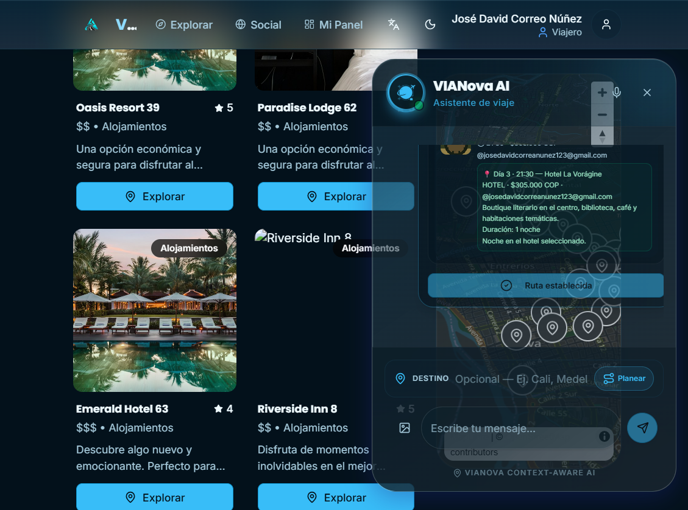
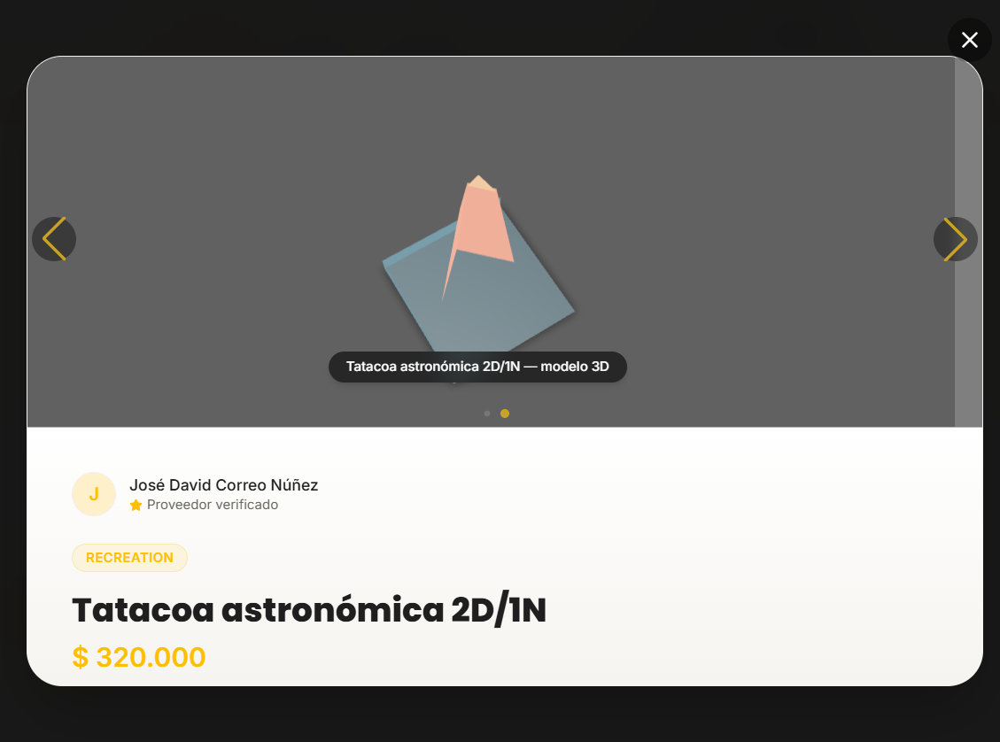

# Seed Neiva — VIANova

Fecha de ejecución: **2026-10-25**  
Entorno validado: desarrollo local (`http://localhost:5000`), Neon PostgreSQL y Cloudinary.

## 1. Resumen

Se cargó un catálogo completo de **Neiva, Huila** asociado a la cuenta demo, se crearon productos para los tres roles de proveedor y se verificó el flujo completo de dashboards, marketplace, multimedia 3D y chatbot con planificación de viajes.

Resultado:

- 12 hoteles, 12 restaurantes y 12 servicios de recreación.
- 36 productos: 12 por cada rol (`hotel`, `restaurant`, `recreation`).
- 48 imágenes PNG y 12 modelos GLB en Cloudinary.
- 72 órdenes, 32 reservas y 36 reseñas generadas para alimentar los dashboards.
- 72 ítems de Neiva visibles en el catálogo restringido del chatbot.
- Viaje de prueba de 3 días y 2 viajeros con **16 paradas**.
- Ruta establecida con **16 mensajes persistidos**, uno por parada.
- Dashboards de hotel, restaurante, recreación y viajero funcionando.
- Visor 3D real del marketplace cargando los GLB sembrados.

## 2. Credenciales demo

| Campo | Valor |
|---|---|
| Usuario | `josedavidcorreanunez123@gmail.com` |
| Contraseña | Definida por `SEED_DEMO_PASSWORD` (no versionada) |
| ID | `8d6a7b90-a1db-470d-9351-8d0c1d24b7bb` |
| Roles | `traveler`, `hotel`, `restaurant`, `recreation` |
| Rol base del seed | `restaurant` |
| Rol activo al cerrar la validación | `traveler` |

Los roles se cambian desde **Mi Panel → Cambiar rol**. El rol activo determina el dashboard y el tipo de asistente del chatbot.

> La contraseña demo se define con `SEED_DEMO_PASSWORD` y no se versiona. No se documentan secretos de Neon, Cloudinary ni Groq.

## 3. Datos sembrados

### 3.1 Servicios

| Categoría | Cantidad | Nombres |
|---|---:|---|
| Hotel | 12 | Apartahotel Las Ceibas, Hostería Agua de Coco, Hostería Casa de Guadua, Hotel Bahía Conquistador, Hotel Centro Histórico Neiva, Hotel EcoCampus Neiva, Hotel La Vorágine, Hotel Mirador del Huila, Hotel Plaza Neiva, Hotel Río Magdalena, Hotel Tatacoa Star, Posada El Cedro |
| Restaurante | 12 | Café La Ceiba, Comidas Típicas Doña Emilia, Food Truck Ruta 45, La Casa del Achira, Mercado Gourmet Neiva, Parrilla Los Arrayanes, Pizzería El Tizón, Restaurante Asado Huilense, Restaurante El Faro del Magdalena, Restaurante Mirador La Concha, Restaurante Vegano Guacamayo, Sabor Opita |
| Recreación | 12 | Avistamiento de Aves Río Las Ceibas, Cañón del Magdalena Hike, Cicloturismo por Neiva, Cuevas de los Guácharos, Desierto de la Tatacoa Stargazing, Museo de la Cultura Huilense, Parque Arqueológico Alto Magdalena, Parque del Amor Mirador, Represa de Betania Kayak, Ruta del Café Huilense, Río Magdalena Paseo en Lancha, Termales de Rivera |

### 3.2 Productos

| Rol | Cantidad | Productos |
|---|---:|---|
| Hotel | 12 | Escapada romántica 2 noches, Fin de semana de aventura, Hospedaje para grupos, Hostal mochilero 3 noches, Late check-out y spa, Luna de miel huilense, Noche de estrellas + desayuno, Noche de lujo en Neiva, Pasadía ecológico en la Tatacoa, Plan familiar hotel + desayuno, Retiro de bienestar 2 días, Suite ejecutiva con vista al río |
| Restaurante | 12 | Almuerzo típico para grupos, Asado huilense para 2, Cata de achiras y vinos, Cena maridaje con café, Cena romántica junto al río, Desayuno típico + city tour, Experiencia chef por un día, Menú vegetariano del Huila, Parrillada familiar, Picnic en el mirador, Ruta gastronómica opita, Tour de café y postres |
| Recreación | 12 | Bici tour urbano, Birdwatching al amanecer, Café experience, Campamento bajo las estrellas, Espeleología en guácharos, Kayak en Betania, Lancha por el Magdalena, Museo + taller de arte, Ruta arqueológica guiada, Senderismo al Cañón, Tatacoa astronómica 2D/1N, Termales relax day pass |

### 3.3 Multimedia

| Recurso | Cantidad | Detalle |
|---|---:|---|
| Imágenes PNG | 48 | Pósters originales generados proceduralmente, subidos a `vianova/neiva/images` |
| Modelos GLB | 12 | Landmarks low-poly generados proceduralmente, subidos a `vianova/neiva/3d` |
| `media_assets` de productos | 48 | 36 `IMAGE` + 12 `MODEL_3D` |
| Portadas de servicios | 36 | Cada servicio usa una de las 48 imágenes como `image_url` |

Verificación de Cloudinary:

- PNG: HTTP `200`, `content-type: image/png`.
- GLB: HTTP `200`, `content-type: model/gltf-binary`, magic bytes `glTF`.
- Los 12 modelos están asociados a 12 productos distintos.

### 3.4 Datos para dashboards

| Dato | Cantidad |
|---|---:|
| Órdenes | 72 |
| Reservas | 32 |
| Reseñas/comentarios | 36 |
| Viajes de prueba | 4 (3 `routed`, 1 `draft`) |
| Paradas por viaje | 16 |

Los viajes de prueba se conservan en la cuenta demo. El seed los elimina y recrea cuando se vuelve a ejecutar.

## 4. Catálogo restringido del chatbot

El chatbot **no consulta las tablas completas** de la base de datos ni recomienda resultados de internet.

Implementación:

- Vista `catalog.catalog_items`: unión normalizada de servicios y productos activos.
- Rol PostgreSQL de solo lectura `vianova_catalog_reader`.
- Variable `CATALOG_DATABASE_URL`: conexión exclusiva del catálogo.
- `server/catalog.ts` expone `searchCatalog()`, `buildCatalogContext()` y `buildCatalogFallbackReply()`.
- `/api/chat` usa únicamente ese catálogo para responder y para generar viajes.

Verificación de aislamiento:

```text
catalog_rows 338
users_access BLOCKED 42501 permission denied for table users
products_access BLOCKED 42501
```

Del total de la vista, **72 ítems corresponden a Neiva**:

| Categoría | Ítems |
|---|---:|
| Hotel | 24 (12 servicios + 12 productos) |
| Restaurante | 24 (12 servicios + 12 productos) |
| Recreación | 24 (12 servicios + 12 productos) |

## 5. Planificador de viajes y mensajes por parada

Cambios principales:

- `server/trips.ts`: generación de viajes desde el catálogo, persistencia de paradas y establecimiento de ruta.
- `server/routes/trips.routes.ts`:
  - `GET /api/trips/latest`
  - `POST /api/trips/:id/route/establish`
- `client/src/components/TripPlannerPanel.tsx`: panel de viaje dentro del chat.
- `client/src/components/Chatbot.tsx`: detecta la intención de viaje, muestra el panel y agrega los mensajes de ruta.
- Tablas `trips` y `trip_stops`.
- Al establecer la ruta se escribe **un mensaje de asistente por parada** en `messages`, con metadata `type = "trip_stop"`, `tripId`, `stopId` y `dayNumber`.

Validación del flujo:

```text
Plan: 3 días, 2 viajeros, 16 paradas
Ruta: status = routed, 16 mensajes de parada
Viaje UI: 16 tarjetas de parada + 16 mensajes en el chat
```

El botón **“Establecer ruta y notificar paradas”** queda deshabilitado como **“Ruta establecida”** después de completar el proceso.

## 6. Validación de API

| Endpoint / flujo | Resultado |
|---|---|
| `POST /api/auth/login` | `200`, login demo correcto |
| `GET /api/users/:username/roles` | `200`, cuatro roles |
| `PATCH /api/users/active-role` | `200` para hotel, restaurante, recreación y viajero |
| `GET /api/analytics/dashboard` (hotel) | Ingresos `$30.985.000`, 46 órdenes, 12 productos, 24 reservas |
| `GET /api/analytics/dashboard` (restaurante) | Ingresos `$6.026.000`, 22 órdenes, 12 productos |
| `GET /api/analytics/dashboard` (recreación) | Ingresos `$5.290.000`, 22 órdenes, 12 productos |
| `GET /api/analytics/dashboard` (viajero) | `200`, vista consumidor |
| `GET /api/products/provider/:username` | 12 productos por rol, con imagen y `model_3d` |
| `POST /api/chat` con intención de viaje | `200`, viaje de 16 paradas |
| `POST /api/trips/:id/route/establish` | `200`, 16 mensajes creados |
| `GET /api/chat/history` | Historial con mensajes de parada |
| `GET /api/services?category=...` | Servicios de Neiva con imágenes de Cloudinary |

## 7. Validación de UI

- Login con la cuenta demo: correcto.
- Home: catálogo y servicios de Neiva visibles.
- **Mi Panel**:
  - Hotel: métricas, gráficos, órdenes, reservas y tabla de productos.
  - Restaurante: métricas y productos.
  - Recreación: métricas y productos.
  - Viajero: vista consumidor.
- `/products`: 12 productos de recreación, 50 órdenes del rol, imágenes y acciones.
- `/explore`: el modal de producto carga:
  - Portada PNG de Cloudinary.
  - Slide 3D con `<model-viewer>` real.
  - GLB cargado (`loaded = true`, `modelIsVisible = true`).
- Chatbot:
  - Mensaje: “Quiero un viaje de 3 días a Neiva para 2 personas”.
  - Respuesta con itinerario y panel **VIAJE A NEIVA**.
  - 16 paradas agrupadas por día.
  - Botón de establecimiento de ruta.
  - 16 mensajes `📍 Día N · HH:MM — …` agregados al chat.

Capturas:





## 8. Correcciones de código relevantes

| Archivo | Cambio |
|---|---|
| `server/catalog.ts` | Nuevo catálogo restringido, consultas y contexto/fallback para el chatbot |
| `server/trips.ts` | Nuevo planificador, tablas y mensajes por parada |
| `server/routes/trips.routes.ts` | Nuevos endpoints de viajes |
| `server/routes/index.ts` | `/api/chat` usa catálogo restringido; integración de viajes; normalización `MODEL_3D` → `3d_model` |
| `client/src/components/TripPlannerPanel.tsx` | Nuevo panel de viaje y establecimiento de ruta |
| `client/src/components/Chatbot.tsx` | Integración del plan de viaje y mensajes de ruta |
| `client/src/components/media/MediaGallery.tsx` | Acepta `3d_model` y `model_3d` para renderizar el visor 3D |
| `client/src/pages/ProductManager.tsx` | Etiqueta 3D compatible con ambos nombres de tipo |
| `server/security.ts` | `isValidUsername` acepta `@` para usuarios tipo correo |
| `.env.example`, `.dev.vars.example` | Se documenta `CATALOG_DATABASE_URL` sin valores reales |
| `scripts/neiva-assets.mjs` | Generadores de 48 PNG y 12 GLB |
| `scripts/seed-neiva.mjs` | Seed idempotente de datos, multimedia, roles y catálogo restringido |

## 9. Variables de entorno necesarias

Los valores reales están solo en `.env` y `.dev.vars` (ignorados por Git). No se incluyen en este documento.

```text
DATABASE_URL
CATALOG_DATABASE_URL
CLOUDINARY_CLOUD_NAME
CLOUDINARY_API_KEY
CLOUDINARY_API_SECRET
GROQ_API_KEY
```

`CATALOG_DATABASE_URL` debe usar el rol `vianova_catalog_reader`, no el usuario administrador de Neon.

## 10. Cómo reproducir el seed

```bash
# Reutiliza las 48 imágenes y 12 modelos ya subidos
node scripts/seed-neiva.mjs --reuse-assets

# Vuelve a generar y subir todos los assets
node scripts/seed-neiva.mjs

# Solo datos, sin tocar Cloudinary
node scripts/seed-neiva.mjs --db-only

# Solo assets, sin tocar la base de datos
node scripts/seed-neiva.mjs --assets-only

# Verificación de tipos
npm run check
```

El seed es idempotente por nombre de servicio/producto:

- Elimina los servicios/productos sembrados previamente para la cuenta demo.
- Elimina sus medios, órdenes, reservas, reseñas y viajes de la cuenta demo.
- Vuelve a insertar todo.
- Recrea el usuario demo y sus roles.
- Reaplica los permisos del rol de catálogo.

## 11. Limitaciones y notas

- **Groq**: durante parte de la validación la API devolvió `403 Access denied. Please check your network settings.` El chatbot siguió funcionando con el fallback determinista basado exclusivamente en el catálogo. En la validación final de UI, Groq respondió correctamente. Si vuelve el 403, el flujo de viajes y mensajes por parada no se bloquea.
- **3D**: los GLB son modelos low-poly generados para la demo. El visor real de productos está en `/explore` → producto → slide 3D. El botón 3D del Home para datos mock conserva el visor genérico anterior.
- **Roles**: el dashboard cambia según el rol activo. Para ver las métricas sembradas hay que entrar como `hotel`, `restaurant` o `recreation`; como `traveler` se ve la vista consumidor.
- **Secretos**: no se deben commitear `.env`, `.dev.vars` ni archivos de credenciales. Para producción, cargar los secretos con el gestor correspondiente (por ejemplo, `wrangler secret put` si se despliega en Cloudflare).

## 12. Estado final

- `npm run check`: **OK**.
- API de login, roles, dashboards, productos, chat y viajes: **OK**.
- UI de login, dashboards, marketplace, visor 3D y chat: **OK**.
- Catálogo restringido: **OK**, sin acceso a `public.users` ni `public.products`.
- Seed de Neiva: **completado**.
