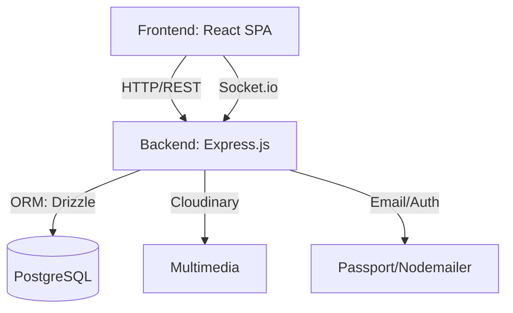

# Informe Técnico: ViaNovaIA

Este documento proporciona una visión sintetizada de la arquitectura, stack tecnológico y flujo de trabajo del proyecto ViaNovaIA.

---

## 1. Visión General
ViaNovaIA es una plataforma **Full-Stack** diseñada para la gestión integral de turismo y servicios locales. Su arquitectura es **isomorfa**, utilizando TypeScript tanto en el servidor (Node.js/Express) como en el cliente (React SPA), lo que garantiza una comunicación fluida y tipada.

## 2. Stack Tecnológico

### Backend (Server-Side)
- **Runtime:** Node.js (v20+)
- **Framework:** Express.js 4.x
- **Persistencia:** PostgreSQL (vía Drizzle ORM)
- **Autenticación:** Passport.js (Estrategia Local), Sesiones persistentes
- **Comunicación:** REST API + WebSockets (Socket.io)
- **Validación:** Zod (Esquemas de validación)

### Frontend (Client-Side)
- **Framework:** React 19 + Vite (v7)
- **Routing:** Wouter (Enrutamiento ligero)
- **UI:** Tailwind CSS (v4), Radix UI (Componentes headless), Framer Motion
- **Visualización:** Three.js (@react-three/fiber), Mapbox GL / Leaflet
- **Estado:** TanStack React Query (Gestión de datos de servidor)

### Infraestructura y Movilidad
- **Mobile:** Capacitor (Android)
- **Cloud:** Cloudflare Workers (Wrangler), Vercel
- **Assets:** Cloudinary (Almacenamiento de multimedia)

---

## 3. Diagrama de Flujo de Datos



---

## 4. Estructura del Proyecto

```text
├── client/          # Aplicación React: UI, Components, Pages, Assets
├── server/          # Servidor Express: API, Middleware, Auth, Sockets
├── shared/          # Esquemas Drizzle, tipos TS, validaciones Zod (Isomorfismo)
├── scripts/         # Automatización: Migraciones, CI/CD, Deployment
└── vianova.env.txt  # Variables de entorno
```

---

## 5. Modelado de Datos (Estructura Base)
La base de datos utiliza un sistema de roles y servicios centralizado:
- **`users`**: Almacena perfiles de usuarios con roles dinámicos (viajero, taxista, hotel, etc.).
- **`services`**: Catálogo de ofertas de servicios turísticos.
- **`bookings` / `availability_slots`**: Sistema de reservas temporales con bloqueo optimista.
- **`posts` / `social_likes`**: Módulos de red social integrada.
- **`reviews`**: Sistema de reputación bidireccional entre usuarios.

---

## 6. Puntos Clave de la Arquitectura
1. **Source of Truth:** Los esquemas definidos en `shared/schema.ts` son la única fuente de verdad para el cliente y el servidor.
2. **Seguridad:** Implementación de `express-rate-limit`, validación con `zod`, y gestión de tokens para reseteo de contraseñas.
3. **Escalabilidad:** Se recomienda el uso de colas (BullMQ) y optimización 3D mediante instancing para mejorar el rendimiento bajo carga.
4. **Despliegue:** Preparado para entornos serverless (Cloudflare/Vercel) y nativo (Capacitor/Android).
